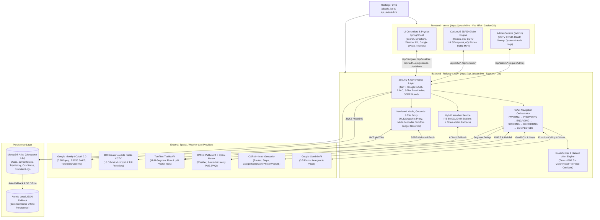
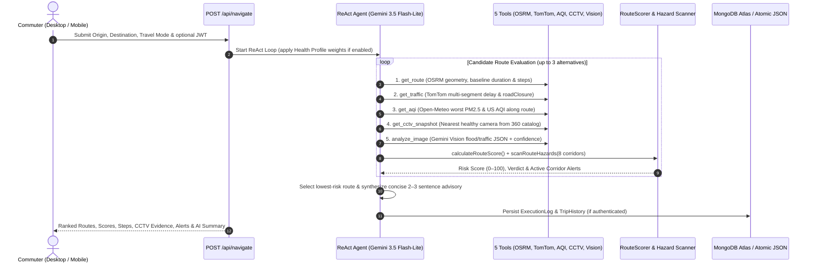

<div align="center">

# JakSafe

### Agentic 3D Urban Intelligence & Multi-Criteria Safe Navigation for Greater Jakarta

Photorealistic 3D/2D city canvas. Live public CCTV vision, street-level air quality (PM2.5), hybrid **BMKG + Open-Meteo** weather, real-time traffic flow vector tiles, and an autonomous **ReAct AI Agent** that inspects your route before you drive into floodwater, gridlock, or hazardous air.

*Don't just take the fastest route — take the safest one.*

[](https://jaksafe.live)
[](LICENSE)
[](https://nodejs.org/)
[](https://cesium.com/platform/cesiumjs/)
[](https://ai.google.dev/)
[-16A34A?style=flat-square)](#testing--security-hardening)

**Live Demo:** **[https://jaksafe.live](https://jaksafe.live)** · **API Health:** **[https://api.jaksafe.live/api/health](https://api.jaksafe.live/api/health)**

**Starts without paid API keys.** OSRM routing, Open-Meteo PM2.5 air quality, BMKG Jabodetabek weather (43 ADM4 stations), multi-provider geocoding, **360 verified Greater Jakarta public CCTV cameras**, OSM 3D buildings, and deterministic multi-criteria scoring work out of the box. Add optional Gemini, TomTom, Google Maps, or Google OAuth keys anytime. **[→ Quick Start](#quick-start)**

</div>

---

<div align="center">

**[Why JakSafe](#why-jaksafe-exists) · [Key Features](#what-this-thing-does) · [System Architecture](#system-architecture) · [Scoring Engine](#multi-criteria-route-scoring) · [Data & CCTV Sources](#data-sources--cctv-catalog) · [Quick Start](#quick-start) · [API Keys](#api-keys--data-tiers) · [Testing & Security](#testing--security-hardening)**

</div>

---

## Why JakSafe Exists

Standard navigation apps optimize for a single variable: **estimated arrival time**. In a megacity like **DKI Jakarta & Jabodetabek**, the "fastest" route on paper can send a commuter, motorcyclist, cyclist, or asthma-sensitive passenger straight through:

1. **Sudden street-level inundation (*banjir/genangan*)** at underpasses and river corridors before crowd-sourced reports catch up.
2. **Hazardous PM2.5 pollution pockets** along congested arterial corridors.
3. **Unreported bottlenecks or road closures** visible on municipal traffic cameras long before average speed models react.

**JakSafe** fuses live urban signals into a single **3D/2D situational cockpit** and delegates route verification to an autonomous **ReAct (Reasoning + Acting) AI Agent**:

> Half the magic is watching Greater Jakarta light up with live traffic vector tiles, BMKG weather, AQI zones, and 360 live cameras. The other half is an AI agent that actually *looks* through those cameras with computer vision and scores every alternative route from `0` (safest) to `100` (highest risk).

---

## What This Thing Does

- **Autonomous ReAct Navigation Agent:** Powered by **Gemini 3.5 Flash-Lite** (with automatic fallback chain `gemini-3.5-flash` → `gemini-flash-latest`) orchestrating 5 function-calling tools (`get_route`, `get_traffic`, `get_aqi`, `get_cctv_snapshot`, `analyze_image`). When quota is unavailable, a deterministic pipeline executes the same verification workflow seamlessly.
- **Computer Vision Flood & Road Inspection:** Samples live frames from **360 verified public CCTV cameras** across **16 official Greater Jakarta providers** and inspects them via **Gemini Vision** (strict JSON Schema output for flood presence/depth, traffic density, visibility, and confidence floor guardrail `< 0.4`).
- **Hybrid BMKG + Open-Meteo Weather HUD:** Always-on Apple Maps-style frosted **Weather Pill & Popover** backed by **43 verified BMKG ADM4 stations** across Jabodetabek (30-min cache) with automatic **Open-Meteo Forecast** fallback, smart viewport syncing (`> 2.5 km`, `650 ms` debounce), and zoom-adaptive City/District labels.
- **Personalized Multi-Criteria Route Scoring (`0–100`):** Evaluates **Travel Time & TomTom Delay (`40%`)**, **Air Quality PM2.5 (`35%`)**, and **Road/Flood Condition (`25%`)** into clear verdicts (**`SAFE`** `0–29` · **`CAUTION`** `30–59` · **`AVOID`** `60–100`), dynamically elevating air-quality weight when **Health Sensitivity Profile** is enabled.
- **3D & 2D Geospatial City Canvas:** Built on **CesiumJS 1.146** with one-click switching across **3D**, **2D Map**, and **Satellite** modes, **Google Photorealistic / OSM 3D Buildings**, **TomTom `.pbf` Vector Traffic Tiles**, **Live HLS (`hls.js`) + Snapshot CCTV**, and **AQI PM2.5 Zones**.
- **4 Travel Modes, Turn-by-Turn & Click-to-Pick:** Supports `Car`, `Motor`, `Bike`, and `Walk` with up to 3 alternative routes, interactive **Turn-by-Turn step fly-to**, **Click-to-Pick** reverse geocoding, and a **Multi-Provider Indonesian Geocoder** (0ms local Gazetteer + Google Geocoding + Nominatim + Photon + ArcGIS + Indonesian Address Parser).
- **Hybrid Authentication (JWT + Google OAuth 2.0):** Email/password auth (`bcryptjs` + JWT HS256 + `tokenVersion` revocation) paired with **Google OAuth 2.0 Sign-In** (theme-matched native button + backend cryptographic verification via Google RS256 JWKS & OAuth2 Tokeninfo/Userinfo), unlocking **Health Profile**, **Saved Routes**, **Trip History**, and **Flood-Prone Corridor Alerts** (8 monitored Jakarta corridors).
- **Mobile-First Fluid UX:** Apple-inspired interactive **Spring Bottom-Sheet** (`peek` / `half` / `expanded` with velocity handoff, momentum projection, rubber-banding, `100dvh` + `safe-area-inset-*`), horizontally scrollable layer rail, light/dark/high-contrast themes, and automatic **mobile camera viewport framing** so pins and routes stay centered above the sheet.
- **Operations & Admin Console (`/admin`):** Role-protected console for CCTV catalog CRUD (non-destructive overrides & restore), live camera health probes & scheduled background sweeps, TomTom daily budget telemetry, LRU cache controls, and `ExecutionLog` audit trails.

---

## System Architecture

JakSafe uses a **decoupled client-server architecture** deployed across **Vercel** (`https://jaksafe.live`), **Railway + CDN Edge Caching** (`https://api.jaksafe.live`), **Hostinger DNS**, and **MongoDB Atlas** (with automatic atomic local JSON fallback). All third-party spatial, AI, and CCTV requests are brokered through `/api/*` on the backend.

### High-Level Architecture & Production Deployment



### Autonomous ReAct Agent Lifecycle

Every navigation request (`POST /api/navigate`) executes a verified 6-state lifecycle (`WAITING → PREPARING → ENGAGING → SCORING → REPORTING → COMPLETED`):



---

## Multi-Criteria Route Scoring

`RouteScorer` (`backend/src/scoring/routeScorer.js`) normalizes three real-world urban risk dimensions onto a **`0–100` risk scale** (lower is safer) and combines them via weighted linear scoring ($\sum w = 1.0$):

$$\text{Risk Score} = w_{\text{time}} \cdot S_{\text{time}} + w_{\text{aqi}} \cdot S_{\text{aqi}} + w_{\text{cond}} \cdot S_{\text{cond}}$$

| Dimension | Default Weight | Input Signals | Risk Normalization (`0 = Best` → `100 = Worst`) |
| :--- | :---: | :--- | :--- |
| **Travel Time (`S_time`)** | **40%** | OSRM baseline × `(1 + TomTom delayPercent / 100)` | `0` at `≤ 5 min`, `100` at `≥ 60 min` (linear interpolation); `+60 min` penalty on `roadClosure` |
| **Air Quality (`S_aqi`)** | **35%** | Open-Meteo worst-point PM2.5 (`µg/m³`) along corridor | `0` at `≤ 12 µg/m³`, `100` at `≥ 150 µg/m³` (linear interpolation); weight elevated when **Health Profile** is active |
| **Road & Flood (`S_cond`)** | **25%** | Gemini Vision flood depth + TomTom congestion proxy | Flood: `none +0`, `minor +35`, `moderate +65`, `severe +95`; Congestion: `≥ 80% +30`, `≥ 30% +15`; Guardrail: `confidence < 0.4` floors score to `45` (`Caution`) |

**Safety Verdict Thresholds:**
- 🟢 **`SAFE` / `AMAN` (`0 – 29`):** Smooth corridor, cleaner air, no inundation detected.
- 🟡 **`CAUTION` / `HATI-HATI` (`30 – 59`):** Moderate slowdown, elevated PM2.5, or low-confidence visual check — proceed with care.
- 🔴 **`AVOID` / `HINDARI` (`60 – 100`):** Severe congestion, road closure, hazardous air quality, or floodwater detected.

---

## Data Sources & CCTV Catalog

### Verified 360-Camera Greater Jakarta CCTV Catalog
Maintained via `backend/scripts/scrapeAndMergeCctv.mjs` (`npm run scrape:cctv`) with multi-source scraping, ArcGIS coordinate resolution, `80 m` spatial deduplication, and live snapshot probing across **16 official providers**:

| Provider | Cameras | Provider | Cameras |
|---|---:|---|---:|
| Jasa Marga / Bina Marga Tol | **86** | Pemkot Bekasi (ATCS) | **14** |
| Pemkot Bogor (BSW) | **53** | PT Jakarta Tollroad Development | **13** |
| Hutama Karya Tol JORR S | **51** | PT Bintaro Serpong Damai (Tol BSD) | **11** |
| Dishub Kota Depok | **29** | PT Trans Bumi Serbaraja | **5** |
| Pemprov DKI Jakarta (Balitower) | **25** | Tol KLBM Jawa Timur | **4** |
| DPUPR Kota Tangerang (Sipantau) | **25** | PT CMNP Tol Wiyoto Wiyono | **3** |
| PT CTP Tollways (Cibitung–Cilincing) | **19** | PT KKDM Tol Becakayu | **3** |
| PT Cimanggis Cibitung Tollways | **18** | Diskominfotik Pemprov DKI Jakarta | **1** |

- **Weather Data:** **43 verified BMKG ADM4 stations** (`backend/src/data/bmkgAdm4Jabodetabek.json`) via `api.bmkg.go.id/publik/prakiraan-cuaca` with automatic fallback to `api.open-meteo.com/v1/forecast`.
- **Flood Corridor Alerts:** **8 monitored flood-prone Jakarta corridors** (`hazardAlertService.js`) combining historical drainage risk, 5-sector Open-Meteo rainfall, and live Gemini Vision observations.

---

## Quick Start

### Prerequisites
- **Node.js** `20.x`, `22.x`, or `24.x` (native ESM + `node:test`)
- **npm** `10+`
- **MongoDB** *(Optional)* — Automatically falls back to atomic local JSON (`backend/src/data/jaksafe_local_storage.json`) if MongoDB is unavailable.

### 1. Clone & Install Dependencies

```bash
git clone https://github.com/ValiantJoshua/JakSafe.git
cd JakSafe

cd backend && npm install
cd ../frontend && npm install
```

### 2. Configure Environment Variables

```bash
cp backend/.env.example backend/.env
cp frontend/.env.example frontend/.env
```

> **Zero-Key Mode:** Leave `GEMINI_API_KEY`, `TOMTOM_API_KEY`, `GOOGLE_MAPS_API_KEY`, and `GOOGLE_CLIENT_ID` blank to start immediately with OSRM routing, BMKG + Open-Meteo weather/AQI, Nominatim/Photon geocoding, 360 CCTV streams, and deterministic scoring.

### 3. Start Development Servers

```bash
# Terminal 1 — Backend API Gateway (http://localhost:3001)
cd JakSafe/backend
npm run dev

# Terminal 2 — Frontend Vite Dev Server (http://localhost:5173)
cd JakSafe/frontend
npm run dev
```

Open **`http://localhost:5173`** (or **`http://localhost:5173/admin.html`** for the Admin Console).

---

## API Keys & Data Tiers

🟢 **No key required** · 🟡 **Free tier with signup** · 🔴 **Metered / Billing enabled**

| Tier | Variable | Provider | What It Enables in JakSafe |
| :---: | :--- | :--- | :--- |
| 🟢 | *None* | **OSRM + BMKG + Open-Meteo + Nominatim/Photon + 360 CCTV** | Multi-alternative routing, 43-station BMKG weather, hourly PM2.5 AQI, 360 live CCTV streams, multi-provider geocoding, deterministic scoring |
| 🟡 | `GEMINI_API_KEY` | [Google AI Studio](https://aistudio.google.com/) | **Gemini 3.5 Flash-Lite** ReAct navigation agent + CCTV Vision flood/traffic detection |
| 🟡 | `TOMTOM_API_KEY` | [TomTom Developer](https://developer.tomtom.com/) | Live `.pbf` vector traffic tiles + multi-segment congestion delay calibration (`TOMTOM_DAILY_TILE_BUDGET=2400`) |
| 🟡 | `GOOGLE_CLIENT_ID` · `GOOGLE_CLIENT_SECRET` · `VITE_GOOGLE_CLIENT_ID` | [Google Cloud Console](https://console.cloud.google.com/) | **Continue with Google** OAuth 2.0 Sign-In *(never place `GOOGLE_CLIENT_SECRET` in `frontend/.env`)* |
| 🟡 | `VITE_CESIUM_ION_TOKEN` | [Cesium ion](https://cesium.com/ion) | Optional OSM 3D Buildings & ion-hosted 3D tilesets |
| 🔴 | `GOOGLE_MAPS_API_KEY` · `VITE_GOOGLE_MAPS_API_KEY` | [Google Cloud Console](https://console.cloud.google.com/) | Google 2D/Satellite basemaps, Photorealistic 3D Tiles, and high-precision Google Geocoding |

<details>
<summary><strong>Full <code>backend/.env</code> & <code>frontend/.env</code> Reference</strong></summary>

```env
# backend/.env (Railway Variables)
PORT=3001
MONGODB_URI=mongodb://localhost:27017/jaksafe
CORS_ORIGINS=https://jaksafe.live,https://www.jaksafe.live
TRUST_PROXY=1
CCTV_FILE_PATH=./src/data/cctvCatalog.json
CCTV_SWEEP_INTERVAL_MINUTES=360

GEMINI_API_KEY=
TOMTOM_API_KEY=
TOMTOM_DAILY_TILE_BUDGET=2400
GOOGLE_MAPS_API_KEY=

JWT_SECRET=change-this-to-at-least-32-random-characters
GOOGLE_CLIENT_ID=
GOOGLE_CLIENT_SECRET=
ADMIN_EMAIL=
ADMIN_PASSWORD=
ADMIN_EMAILS=
RATE_LIMIT_API_MAX=240
RATE_LIMIT_AUTH_MAX=25
RATE_LIMIT_HEAVY_MAX=35
RATE_LIMIT_ADMIN_MAX=120
```

```env
# frontend/.env (Vercel Environment Variables)
VITE_BACKEND_ORIGIN=http://localhost:3001
VITE_API_BASE=/api                     # Production: https://api.jaksafe.live/api
VITE_GOOGLE_MAPS_API_KEY=
VITE_GOOGLE_CLIENT_ID=
VITE_CESIUM_ION_TOKEN=
```

</details>

---

## Under the Hood

```text
JakSafe/
├── backend/
│   ├── scripts/
│   │   └── scrapeAndMergeCctv.mjs   # Multi-source scraper & spatial deduplicator (360 cameras)
│   ├── src/
│   │   ├── app.js                   # Express factory, 5-tier rate limiters, CORS & 12 route groups
│   │   ├── server.js                # HTTP server bootstrap, MongoDB init & background CCTV sweep
│   │   ├── agent/                   # reactAgent.js (Gemini 3.5 Flash-Lite) + 5 function-calling tools
│   │   ├── scoring/                 # routeScorer.js (multi-criteria risk engine + health weights)
│   │   ├── services/                # osrm, tomtom, openMeteo, weatherService (BMKG+fallback),
│   │   │                            # cctvCatalog, cctvFrame, cctvHealthService, geminiVision,
│   │   │                            # hazardAlertService, authService (JWT+Google), addressParser, cacheService
│   │   ├── db/                      # mongoClient, storageService, cctvCatalogStore, executionLogStore, models/*
│   │   ├── middleware/              # auth.js (JWT + RBAC), rateLimit.js (5-bucket limiter)
│   │   ├── routes/                  # route, aqi, weather, cctv, tomtom, navigate, geocode,
│   │   │                            # auth, savedRoutes, history, alerts, admin
│   │   ├── utils/                   # atomicJson.js, urlGuard.js (SSRF protection)
│   │   └── data/                    # cctvCatalog.json (360 cams), bmkgAdm4Jabodetabek.json (43 stations)
│   └── tests/                       # 15 test files · 125 unit, integration, security & system tests
│
└── frontend/
    ├── app.html                     # Main 3D/2D Navigation app (viewport-fit=cover)
    ├── admin.html                   # Operations & Admin Console (/admin)
    ├── vercel.json                  # Production SPA/MPA rewrites
    ├── vite.config.js               # Vite MPA config, Cesium plugin & /api proxy
    └── src/
        ├── main.js                  # App bootstrap & deterministic CSS import order
        ├── api/                     # httpClient, authApi, weatherApi, alertsApi, cctvApi, routeApi, adminApi
        ├── map/                     # cesiumViewer, routeLayer, trafficLayer, cctvLayer, aqiLayer,
        │                            # mapControls (spring mobile sheet), mapPicker, weatherPill
        ├── ui/                      # shell, toast, tilt, templates/*, controllers/*
        ├── admin/                   # adminMain.js (Admin Console UI)
        ├── state/                   # appState.js reactive store
        ├── utils/                   # spring.js, dom.js, format.js
        └── styles/                  # tokens, base, layout, components, panels, effects, parts, responsive, admin
```

---

## API Endpoints Overview

| Method | Endpoint | Access | Description |
| :---: | :--- | :---: | :--- |
| `GET` | `/api/health` | Public | Lightweight serviceability health check |
| `POST` | `/api/navigate` | Public *(Heavy RL)* | Runs ReAct AI / deterministic navigation pipeline & returns scored routes |
| `GET` | `/api/route` | Public | Computes OSRM road geometry, alternatives, duration, and turn-by-turn steps |
| `GET` | `/api/weather` | Public | Hybrid BMKG (43 ADM4 Jabodetabek stations) + Open-Meteo fallback weather |
| `GET` | `/api/aqi` | Public | Samples Open-Meteo PM2.5, US AQI, and UV index along coordinates |
| `GET` | `/api/geocode/search` · `/reverse` | Public | Multi-provider Indonesian forward & reverse geocoding |
| `GET` | `/api/cctv/cameras` · `/nearest` | Public | Lists 360 active CCTV cameras with live health status |
| `GET` | `/api/cctv/frame/:id` · `/stream/:id` | Public | SSRF-guarded JPEG snapshot & HLS `.m3u8` stream proxy (`no-store`) |
| `POST` | `/api/cctv/analyze/:id` | Public *(Heavy RL)* | On-demand Gemini Vision flood & traffic condition analysis |
| `GET` | `/api/tomtom/flow/:z/:x/:y` · `/segment` | Public *(Tile RL)* | Cached TomTom `.pbf` vector tiles (`max-age=180`) & segment congestion telemetry |
| `GET/POST` | `/api/alerts` · `/api/alerts/route` | Public | Live status of 8 flood-prone corridors & active route hazard scanning |
| `POST` | `/api/auth/register` · `/login` · `/google` | Public *(Auth RL)* | Email/password & Google OAuth 2.0 authentication (issues JakSafe JWT) |
| `GET/PUT/POST` | `/api/auth/me` · `/profile` · `/logout` | `requireAuth` | Profile, Health Sensitivity, alert preferences & `tokenVersion` revocation |
| `GET/POST/DELETE` | `/api/routes/saved` · `/history` | `requireAuth` | Per-user Saved Routes and Trip History with strict tenant isolation |
| `GET/POST/PUT/DELETE` | `/api/admin/*` · `/api/cache/stats` | `requireAdmin` | Admin CCTV CRUD/override/restore, health sweep, TomTom quota & `ExecutionLog` |

---

## Testing & Security Hardening

JakSafe ships with **125 automated tests across 47 suites (15 test files — 100% passing)** covering Unit Testing (Braude / Humphrey / Myers), Build Integration 1–3, Security & Admin Hardening, and 12+1 System Testing (Kit / IEEE 829):

```bash
cd JakSafe/backend

# Run the complete 125-test suite (Unit + Integration + Security + System)
npm test

# Or run individual tiers
npm run test:unit
npm run test:integration
npm run test:system
```

**Built-in Security Controls:**
- **SSRF Protection (`assertPublicHttpUrl`):** Blocks loopback, RFC 1918 private networks, link-local/cloud metadata (`169.254.169.254`), IPv6 private ranges, non-standard ports, and unvalidated redirects on all CCTV proxy and probe fetches.
- **Cryptographic OAuth & RBAC:** Verifies Google ID Tokens against official RS256 JWKS and OAuth2 access tokens against Google `tokeninfo`/`userinfo` (`aud`/`azp` + `email_verified === true`), enforces `tokenVersion` logout revocation, prevents profile role escalation, and restricts `/api/admin/*` and `/api/cache/stats` strictly to `role === 'admin'`.
- **5-Bucket Sliding-Window Rate Limiter:** Independent buckets for general API, auth (`/login`, `/register`, `/google`), heavy AI/routing compute (`/navigate`, `/cctv/analyze`), traffic tiles, and admin endpoints with `RateLimit-*` and `Retry-After` headers.
- **Atomic Persistence:** Local JSON fallback uses atomic temp-file replacement (`atomicJson.js`) to prevent corruption under concurrent writes.

---

## Responsible & Open

JakSafe is an academic and open-source urban intelligence platform built to improve commuter safety and environmental awareness across **DKI Jakarta & Jabodetabek**.

- **Privacy First:** JakSafe analyzes **road infrastructure, inundation, traffic density, and air quality** — never individuals. System prompts explicitly prohibit facial recognition, license-plate reading (ALPR), or personal identification.
- **Disclaimer:** Road conditions, flood levels, weather, and air quality readings come from public third-party sensors (BMKG, Open-Meteo, TomTom, municipal CCTV) and AI vision inference, which may experience delays. Always follow on-site signage and official guidance from BPBD DKI Jakarta and Dishub.
- **Attribution & License:** Released under the **[MIT License](LICENSE)**. Frontend CesiumJS architecture adapted from [God's Eye View](https://github.com/bilawalsidhu/gods-eye-view) (MIT License, Copyright (c) 2026 Bilawal Sidhu). Weather data attributed to **BMKG (Badan Meteorologi, Klimatologi, dan Geofisika)** and **Open-Meteo**.
