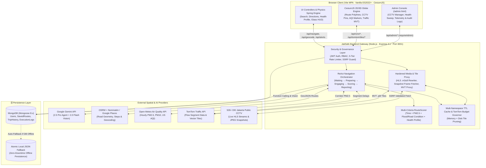
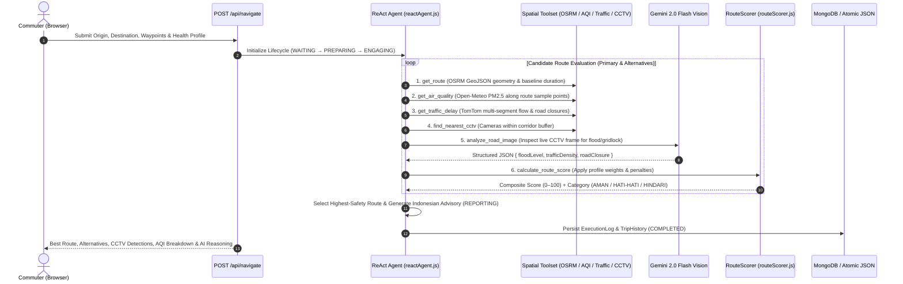

<div align="center">

# JakSafe

### Agentic 3D Urban Intelligence & Multi-Criteria Safe Navigation for DKI Jakarta

Photorealistic 3D city canvas. Live public CCTV vision, street-level air quality (PM2.5), real-time traffic flow tiles, and an autonomous **ReAct AI Agent** that inspects your route before you drive into floodwater, gridlock, or toxic air.

*Don't just take the fastest route — take the safest one.*

[](LICENSE)
[](https://nodejs.org/)
[](https://cesium.com/platform/cesiumjs/)
[](https://ai.google.dev/)
[-16A34A?style=flat-square)](#%EF%B8%8F-testing--security-hardening)

 **Starts without paid API keys.** OSRM routing, Open-Meteo PM2.5 air quality, Nominatim geocoding, 526+ Jakarta public CCTV streams, OSM 3D extruded buildings, and deterministic multi-criteria scoring work out of the box. Add optional Gemini, TomTom, or Google 3D Tiles keys anytime. **[→ Quick Start](#-quick-start)**

</div>

---

<div align="center">

**[Why JakSafe](#-why-jaksafe-exists) · [Key Features](#-what-this-thing-does) · [System Architecture](#-system-architecture) · [Scoring Engine](#-multi-criteria-route-scoring) · [Quick Start](#-quick-start) · [API Keys](#-api-keys--data-tiers) · [Under the Hood](#-under-the-hood)**

</div>

---

## Why JakSafe Exists

Standard navigation apps optimize for a single variable: **estimated arrival time**. In a megacity like **DKI Jakarta**, the "fastest" route on paper can send a commuter, cyclist, or asthma-sensitive passenger straight through:

1. **Sudden street-level inundation (*banjir/genangan*)** at underpasses and river corridors before crowd-sourced reports catch up.
2. **Hazardous PM2.5 pollution pockets** along congested arterial corridors.
3. **Unreported road closures or bottlenecks** visible on municipal traffic cameras long before road-graph speed averages update.

**JakSafe** fuses four live urban signals into a single **3D situational cockpit** and delegates route verification to an autonomous **ReAct (Reasoning + Acting) AI Agent**:

> Half the magic is watching a 3D corridor light up with live traffic vector tiles, AQI badges, and real intersection cameras. The other half is an AI agent that actually *looks* through those cameras with computer vision and scores every alternative route from `0` to `100`.

---

## What This Thing Does

- **Autonomous ReAct Navigation Agent:** Powered by **Gemini 2.5 Pro** function calling (`get_route`, `get_air_quality`, `find_nearest_cctv`, `analyze_road_image`, `calculate_route_score`). If the Gemini quota is exhausted or unconfigured, a **deterministic fallback pipeline** executes the exact same tool chain seamlessly.
- **Computer Vision Flood & Hazard Detection:** Samples live frames from **526+ Jakarta public CCTV cameras** along your corridor and inspects them with **Gemini 2.0 Flash Vision** for flood depth (`none`, `minor`, `moderate`, `severe`), traffic density, and physical road closures.
- **Personalized Multi-Criteria Route Scoring (`0–100`):** Weighs **Travel Time & Traffic Delay**, **Air Quality (PM2.5)**, and **Road/Flood Condition** into a transparent safety verdict (**`AMAN`** / **`HATI-HATI`** / **`HINDARI`**) that adapts to your health profile (*Normal, Sensitive/Asthma, Pregnant/Elderly, Cyclist/Pedestrian, Flood-Averse*).
- **3D & 2D Geospatial City Canvas:** Built on **CesiumJS** with one-click switching between **2D Tactical Map** and **3D Perspective**, **Google Photorealistic 3D Tiles**, **OSM 3D Extruded Buildings**, **Esri World Imagery**, and **CartoDB Positron / Dark Matter** basemaps.
- **Live Corridor CCTV HUD (HLS + Snapshot):** Click any camera pin to watch live `.m3u8` HLS video streams (`hls.js`) or auto-refreshing snapshots directly over the map, brokered through an SSRF-hardened backend proxy.
- **Vector Traffic Flow & Bottleneck Sampling:** Renders live **TomTom `.pbf` vector traffic tiles** on the globe and samples multi-segment speed/delay ratios along short, medium, and long routes with a built-in daily tile budget governor.
- **Proactive Route Hazard Scanner:** Continuously cross-checks active routes against severe AQI spikes (`PM2.5 > 55.4 µg/m³`), severe traffic delays (`> 45%`), and flooded CCTV segments via `/api/alerts/route`.
- **Turn-by-Turn Indonesian Directions & Multi-Stop Waypoints:** Supports origin, destination, and intermediate waypoint (`via`), interactive step-by-step fly-to camera framing, Saved Routes, and Trip History.
- **Operations & Admin Console (`/admin`):** Dedicated dashboard for managing the 526+ CCTV catalog (CRUD, disable/restore overrides), triggering live camera health sweeps, monitoring TomTom quota & cache hit rates, and inspecting the `ExecutionLog` audit trail.

---

## System Architecture

JakSafe uses a strict **decoupled client-server architecture**. The browser client (`jaksafe-frontend`) never calls third-party routing, weather, traffic, or camera endpoints directly — every request flows through `/api/*` on `jaksafe-backend`, protecting private credentials, enforcing rate limits, and preventing CORS/SSRF exposure.

### High-Level Architecture Diagram



### Autonomous ReAct Agent Lifecycle

Every navigation request (`POST /api/navigate`) transitions through a verified 6-state machine (`WAITING → PREPARING → ENGAGING → SCORING → REPORTING → COMPLETED`):



---

## Multi-Criteria Route Scoring

Unlike single-metric routers, `RouteScorer` (`backend/src/scoring/routeScorer.js`) normalizes three real-world urban risk dimensions onto a `0–100` scale and combines them using a weighted linear combination:

$$\text{Composite Score} = w_{\text{time}} \cdot S_{\text{time}} + w_{\text{aqi}} \cdot S_{\text{aqi}} + w_{\text{cond}} \cdot S_{\text{cond}}$$

| Dimension | Default Weight | Input Signals | Score Normalization (`0–100`) |
| :--- | :---: | :--- | :--- |
| **Travel Time (`S_time`)** | **40%** | OSRM baseline duration + TomTom multi-segment bottleneck delay % | `100` at free-flow (`0%` delay), scaling linearly down to `0` at severe gridlock (`>= 100%` delay) |
| **Air Quality (`S_aqi`)** | **30%** | Open-Meteo corridor PM2.5 (`µg/m³`) across sampled coordinates | WHO/EPA breakpoints: `<= 12` (`90–100`), `12–35.4` (`70–90`), `35.4–55.4` (`50–70`), `55.4–150.4` (`20–50`), `> 150.4` (`0–20`) |
| **Road & Flood (`S_cond`)** | **30%** | Gemini Vision CCTV analysis (`floodLevel`, `trafficDensity`, `roadClosure`) | Starts at `100`; deducts for `minor` (`-25`), `moderate` (`-55`), or `severe` (`-85`) flooding, dense traffic, or `0` on full road closure |

**Safety Verdict Thresholds:**
- 🟢 **`AMAN` (`70 – 100`):** Clear corridor, healthy air quality, no flood inundation detected.
- 🟡 **`HATI-HATI` (`40 – 69`):** Moderate congestion, elevated PM2.5, or minor waterlogging (`genangan`) — proceed with caution.
- 🔴 **`HINDARI` (`0 – 39`):** Severe flooding, road closure, or hazardous air quality — take an alternative route.

---

## Quick Start

### Prerequisites

- **Node.js** `20.x`, `22.x`, or `24.x` (ESM native support)
- **npm** `10+`
- **MongoDB** *(Optional)* — If local MongoDB or MongoDB Atlas is not running, JakSafe automatically falls back to its built-in **atomic local JSON store** (`backend/src/data/localStore.json`) with zero configuration required.

### 1. Clone & Install Dependencies

```bash
git clone https://github.com/ValiantJoshua/JakSafe.git
cd JakSafe

# Install backend dependencies
cd backend
npm install

# Install frontend dependencies
cd ../frontend
npm install
```

### 2. Configure Environment Variables

Copy the example environment file in `backend/`:

```bash
cd ../backend
cp .env.example .env
```

> **Zero-Key Mode:** You can leave `GEMINI_API_KEY`, `TOMTOM_API_KEY`, and `GOOGLE_MAPS_API_KEY` blank to start immediately. JakSafe will use OSRM routing, Open-Meteo air quality, Nominatim geocoding, live Jakarta CCTV streams, and the deterministic scoring pipeline.

### 3. Start Backend & Frontend Servers

Open two terminals:

**Terminal 1 — Backend API Gateway (`http://localhost:3001`):**
```bash
cd JakSafe/backend
npm run dev
```

**Terminal 2 — Frontend Vite Dev Server (`http://localhost:5173`):**
```bash
cd JakSafe/frontend
npm run dev
```

Open **`http://localhost:5173`** (automatically redirects to `/app.html`).
To access the **Admin & Operations Console**, open **`http://localhost:5173/admin.html`**.

---

## 🔑 API Keys & Data Tiers

🟢 **No key required** · 🟡 **Free tier with signup** · 🔴 **Metered / Billing enabled**

| Tier | Variable | Provider | What It Enables in JakSafe |
| :---: | :--- | :--- | :--- |
| 🟢 | *None* | **OSRM + Nominatim + Open-Meteo + Jakarta CCTV** | Multi-alternative road routing, place search, hourly PM2.5 air quality, 526+ live CCTV streams, OSM 3D buildings, deterministic safety scoring |
| 🟡 | `GEMINI_API_KEY` | [Google AI Studio](https://aistudio.google.com/) | **Gemini 2.5 Pro** autonomous ReAct reasoning + **Gemini 2.0 Flash Vision** real-time flood & traffic inspection from CCTV frames |
| 🟡 | `TOMTOM_API_KEY` | [TomTom Developer](https://developer.tomtom.com/) | Live `.pbf` vector traffic flow tiles on the map + multi-segment corridor congestion delay sampling (protected by `TOMTOM_DAILY_TILE_BUDGET=2400`) |
| 🟡 | `VITE_CESIUM_ION_TOKEN` | [Cesium ion](https://cesium.com/ion) | World terrain elevation mesh & ion-hosted 3D tilesets (configured in `frontend/.env`) |
| 🔴 | `GOOGLE_MAPS_API_KEY` | [Google Cloud Console](https://console.cloud.google.com/) | **Google Photorealistic 3D Tiles** in CesiumJS + high-precision Google Places Autocomplete & Geocoding |

<details>
<summary><strong>Full <code>backend/.env</code> Reference</strong></summary>

```env
# Server & Persistence
PORT=3001
MONGODB_URI=mongodb://localhost:27017/jaksafe
CCTV_FILE_PATH=./src/data/cctvCatalog.json

# AI & Spatial Providers (Optional — graceful fallback when empty)
GEMINI_API_KEY=
TOMTOM_API_KEY=
TOMTOM_DAILY_TILE_BUDGET=2400
GOOGLE_MAPS_API_KEY=

# Security, Auth & Rate Limiting
JWT_SECRET=change-this-to-a-strong-random-secret
ADMIN_EMAIL=
ADMIN_PASSWORD=
ADMIN_EMAILS=
RATE_LIMIT_API_MAX=240
RATE_LIMIT_AUTH_MAX=25
RATE_LIMIT_HEAVY_MAX=35
RATE_LIMIT_ADMIN_MAX=120
```

> **Admin Role Assignment:** By default, newly registered accounts via `/api/auth/register` are assigned `role: "user"`. You can promote an account to `"admin"` directly in MongoDB / `localStore.json`, or seed an initial admin via `npm run admin:seed` with `ADMIN_EMAIL` and `ADMIN_PASSWORD`.

</details>

---

## Under the Hood

```text
JakSafe/
├── backend/
│   ├── src/
│   │   ├── app.js                  # Express factory, 5-tier rate limiters, CORS & route mounting
│   │   ├── server.js               # HTTP server bootstrap & graceful shutdown
│   │   ├── agent/
│   │   │   ├── reactAgent.js       # Gemini 2.5 Pro ReAct loop + deterministic fallback + state machine
│   │   │   └── tools/              # Agent function-calling tools (route, AQI, CCTV, vision, score)
│   │   ├── scoring/
│   │   │   └── routeScorer.js      # Multi-criteria normalization, health profile weights & categories
│   │   ├── services/
│   │   │   ├── osrm.js             # OSRM routing, waypoints, steps & GeoJSON parser
│   │   │   ├── openMeteo.js        # Corridor PM2.5 / AQI sampling & worst-point extraction
│   │   │   ├── tomtom.js           # Multi-segment traffic flow, MVT tile proxy & daily budget governor
│   │   │   ├── cctvCatalog.js      # 526+ Jakarta cameras, spatial Haversine search & admin overrides
│   │   │   ├── cctvFrame.js        # SSRF-guarded HLS (.m3u8/.ts) stream & JPEG snapshot proxy
│   │   │   ├── cctvHealthService.js# Live camera health probe & background sweep engine
│   │   │   ├── geminiVision.js     # Gemini 2.0 Flash multimodal road/flood image analyzer
│   │   │   ├── authService.js      # bcryptjs password hashing, JWT issuance & token revocation
│   │   │   ├── storageService.js   # Unified Mongoose + atomic local JSON fallback persistence
│   │   │   └── cacheService.js     # Multi-namespace TTL memory cache with hit/miss telemetry
│   │   ├── middleware/             # requireAuth, requireAdmin, sliding-window rateLimiter
│   │   ├── routes/                 # REST endpoints (/navigate, /route, /aqi, /cctv, /tomtom, /auth, /admin)
│   │   └── data/
│   │       └── cctvCatalog.json    # Georeferenced DKI Jakarta public CCTV catalog
│   └── tests/                      # 111 unit, integration & system tests (Node.js native test runner)
│
└── frontend/
    ├── app.html                    # Main 3D/2D Navigation Application entry point
    ├── admin.html                  # Operations & Admin Console entry point
    ├── vite.config.js              # MPA Vite config, Cesium plugin & /api backend proxy
    └── src/
        ├── main.js                 # Application bootstrap & controller wiring
        ├── map/                    # CesiumJS viewer, 3D buildings, route polylines, CCTV & AQI layers, mobile sheet
        ├── ui/                     # Shell layout, search, result cards, turn-by-turn directions, 2D spring tilt
        ├── admin/                  # Admin dashboard logic (CCTV CRUD, probes, monitoring charts)
        ├── services/               # Typed API clients (apiClient, authApi, adminApi)
        ├── utils/                  # Physics spring solver (spring.js), formatter & HTML escaping
        └── styles/                 # Design token system (tokens, layout, components, panels, parts, responsive)
```

---

## API Endpoints Overview

| Method | Endpoint | Access | Description |
| :---: | :--- | :---: | :--- |
| `POST` | `/api/navigate` | Public *(Heavy RL)* | Runs the full ReAct AI / deterministic navigation pipeline and returns scored routes |
| `GET` | `/api/route` | Public | Computes OSRM road geometry, distance, duration, and turn-by-turn steps |
| `GET` | `/api/aqi` | Public | Samples Open-Meteo PM2.5 and US AQI at a coordinate or along a polyline |
| `GET` | `/api/cctv` | Public | Lists active public CCTV cameras or finds nearest cameras to a point/corridor |
| `GET` | `/api/cctv/:id/frame` | Public | Proxies a sanitized JPEG snapshot frame from a public CCTV stream |
| `GET` | `/api/cctv/:id/live.m3u8` | Public | Proxies and rewrites HLS `.m3u8` playlists and `.ts` chunks for in-browser playback |
| `GET` | `/api/tomtom/flow` | Public | Fetches real-time TomTom speed, congestion delay, and road closure telemetry |
| `GET` | `/api/tomtom/tiles/:z/:x/:y.pbf` | Public *(Tile RL)* | Serves cached Mapbox Vector Tiles (`.pbf`) for live road congestion rendering |
| `POST` | `/api/alerts/route` | Public *(Heavy RL)* | Scans an active route geometry for flood, AQI, and severe congestion hazards |
| `POST` | `/api/auth/register` · `/login` | Public *(Auth RL)* | Registers a new user (`role: "user"`) or authenticates and issues a JWT |
| `GET/POST/DELETE` | `/api/routes/saved` · `/history` | `requireAuth` | Manages per-user Saved Routes and Trip History with strict tenant isolation |
| `GET/POST/PUT/DELETE` | `/api/admin/cctv/*` · `/monitoring/*` | `requireAdmin` | Admin CCTV CRUD, health probes, TomTom quota governance, and `ExecutionLog` stats |

---

## Testing & Security Hardening

JakSafe includes a comprehensive **111-test verification suite** across **46 test suites** (Unit, Integration, and 12-Category System Testing following IEEE 829 / Braude / Myers methodologies) plus a defense-in-depth security posture:

```bash
cd JakSafe/backend

# Run the complete 111-test suite (Unit + Integration + System + Security)
npm test

# Or run individual tiers
npm run test:unit
npm run test:integration
npm run test:system
```

**Built-in Security Controls:**
- **SSRF Protection (`assertPublicHttpUrl`):** Blocks loopback, RFC 1918 private networks, link-local/cloud metadata (`169.254.169.254`), IPv6 local ranges, non-standard ports, and unvalidated HTTP redirects on all CCTV proxy and health-probe fetches.
- **Role-Based Access Control (RBAC):** Re-hydrates user state from storage on every authenticated request, enforces token revocation on logout, prevents privilege escalation on profile updates, and locks `/api/admin/*` and `/api/cache/stats` strictly to `role === 'admin'`.
- **5-Bucket Sliding-Window Rate Limiter:** Dedicated rate-limit buckets for general API, authentication (`/login`, `/register`), heavy AI/routing compute (`/navigate`, `/alerts/route`), vector traffic tiles, and admin operations.
- **Atomic Persistence & Race-Condition Safety:** Local JSON fallback uses serialized write queues and atomic temp-file rename (`atomicJson.js`) to prevent data corruption under concurrent requests.

---

## Responsible & Open

JakSafe is an academic and open-source urban intelligence system designed to improve commuter safety and environmental awareness in **DKI Jakarta**.

- **Privacy First:** JakSafe models **road corridors, flood levels, traffic flow, and air quality** — never individuals. It does not perform facial recognition, license-plate tracking (ALPR), or personal surveillance.
- **Disclaimer:** Road conditions, flood levels, and air quality readings are derived from third-party public sensors and AI vision inference, which may be delayed or incomplete. Always obey physical roadblocks, local authorities (BPBD DKI Jakarta / Dishub), and on-site safety signage during severe weather.
- **License:** Released under the **[MIT License](LICENSE)**. Third-party data sources (OpenStreetMap, Open-Meteo, TomTom, Google Maps, DKI Jakarta CCTV) remain governed by their respective terms.
---

<div align="center">
</div>
