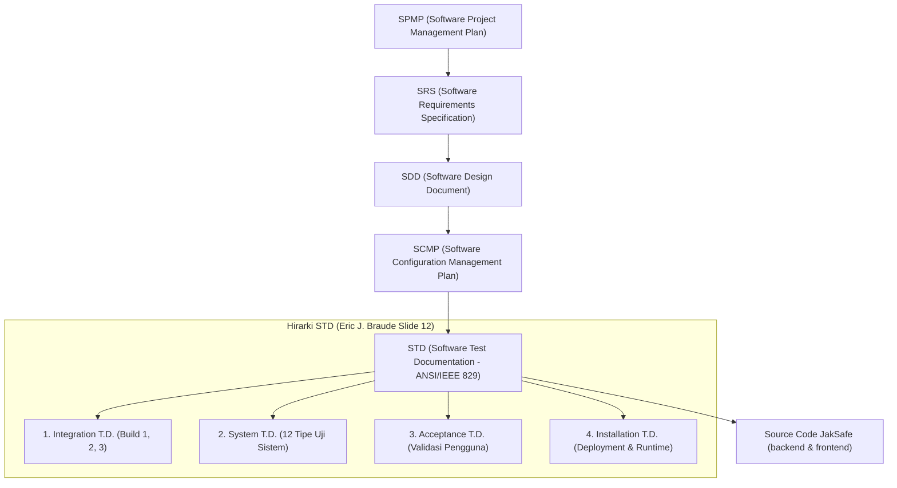
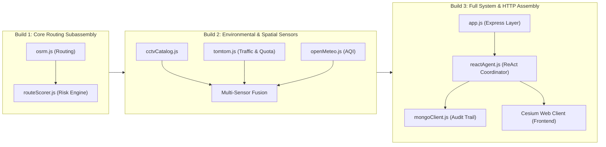
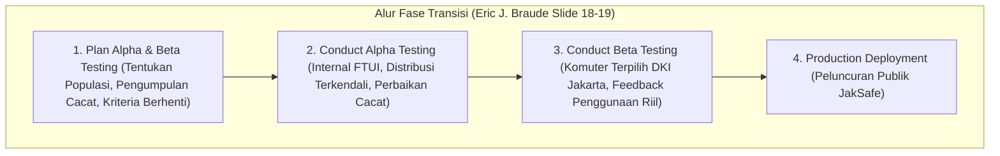

# DOKUMEN PERENCANAAN INTEGRASI & PENGUJIAN SISTEM (SYSTEM INTEGRATION & SYSTEM TEST PLAN)
## Sistem Navigasi Aman & Cerdas DKI Jakarta (JakSafe)

> **Mata Kuliah**: Rekayasa Perangkat Lunak Berorientasi Objek (*Object-Oriented Software Engineering*)  
> **Dosen Pengampu / Acuan Silabus**: Prof. Dr. Ir. Riri Fitri Sari MM MSc, Fakultas Teknik, Universitas Indonesia  
> **Rujukan Teori**: *Software Engineering: An Object-Oriented Perspective* oleh Eric J. Braude (John Wiley & Sons, 2001), Bab 9 (*System Integration*)  
> **Standar Dokumentasi**: ANSI/IEEE Std 829-1983 (*IEEE Standard for Software Test Documentation*, reaff. 1991) & Kit [Ki] (*Software Testing in the Real World*)

---

## 1. Pendahuluan (*Introduction - IEEE 829 Section 1*)

### 1.1 Tujuan Dokumen
Dokumen ini mendefinisikan strategi menyeluruh untuk merakit (*construct in stages*), mengintegrasikan (*subassembly integration*), dan menguji (*system testing*) seluruh komponen perangkat lunak **JakSafe** di luar tingkat pengujian unit (*beyond the unit level*). Rencana ini memastikan bahwa modul-modul independen yang telah lolos uji unit (mesin skoring, katalog CCTV, kuota TomTom, dan agen cerdas) dapat bekerja secara harmonis, andal, aman, dan berkinerja tinggi saat disatukan menjadi satu sistem utuh.

### 1.2 Konteks Dokumentasi Pengujian Sistem (*Documentation in Context - Braude Slide 11*)
Dokumentasi pengujian ini beroperasi dalam ekosistem dokumen rekayasa perangkat lunak JakSafe:

### 1.3 Sasaran Pembelajaran & Integrasi (*Chapter Learning Goals - Braude Slide 4*)
1. Mampu merencanakan integrasi modul-modul berorientasi objek secara bertahap (*Plan integration of modules*).
2. Memahami dan mengimplementasikan ragam pengujian sistem yang disyaratkan (*Understand types of testing required*).
3. Mampu merencanakan dan mengeksekusi pengujian di luar level unit (*Plan and execute testing beyond the unit level*).

---

## 2. Rencana Integrasi Bertahap (*Construct System in Stages / Builds - Braude Slide 3*)

Mengikuti metodologi Eric J. Braude, sistem tidak diintegrasikan secara serentak (*big-bang integration* dihindari), melainkan dirakit secara bertahap dalam 3 *Builds* terencana:

### 2.1 Rincian Subassemblies per Build

#### A. Build 1: Core Routing & Risk Engine Subassembly
* **Fokus**: Integrasi antara layanan pengarah rute OpenStreetMap/OSRM ([`services/osrm.js`](file:///d:/Git/JakSafe/backend/src/services/osrm.js)) dan mesin skoring risiko multi-kriteria ([`scoring/routeScorer.js`](file:///d:/Git/JakSafe/backend/src/scoring/routeScorer.js)).
* **Tujuan**: Memastikan alur data dari koordinat pengguna $\to$ kalkulasi geometri GeoJSON OSRM $\to$ durasi waktu $\to$ pemetaan skor risiko berjalan mulus dan deterministik.
* **Uji Subassembly**: Evaluasi rute alternatif (*alternative routes ranking*) di mana sistem harus memilih rute yang paling aman daripada rute yang tercepat namun berbahaya (misal genangan air tinggi atau jalan ditutup).
* **Verifikasi Regresi (*Regression Testing*)**: Memastikan invarian unit test dari Bab 8 tetap terjaga (rentang skor $0 - 100$ dan jumlah bobot selalu $1.0$).

#### B. Build 2: Environmental & Spatial Sensor Integration Subassembly
* **Fokus**: Integrasi 3 sensor spasial dan lingkungan eksternal:
  1. Katalog Spasial CCTV ([`services/cctvCatalog.js`](file:///d:/Git/JakSafe/backend/src/services/cctvCatalog.js))
  2. Normalisasi Kualitas Udara Open-Meteo ([`services/openMeteo.js`](file:///d:/Git/JakSafe/backend/src/services/openMeteo.js))
  3. Konversi Koordinat Tile & Kuota Harian TomTom ([`services/tomtom.js`](file:///d:/Git/JakSafe/backend/src/services/tomtom.js))
* **Tujuan**:
  - Menguji pencarian spasial kamera CCTV di sepanjang koridor rute navigasi dengan menjaga *Class Invariant: Privacy Protection* (tidak membocorkan URL RTSP/HLS privat).
  - Menguji validasi dinamis nama metrik polusi udara dan penolakan injeksi nama metrik ilegal.
  - Menguji kepatuhan batas kuota TomTom (maksimal 2.400 *tile requests*/hari) dan degradasi terkendali saat kuota menipis.
  - Memadukan (*sensor fusion*) ketiga sumber data menjadi satu objek telemetri untuk masukan skoring.

#### C. Build 3: Full Application & HTTP Assembly
* **Fokus**: Integrasi lapisan HTTP Express ([`app.js`](file:///d:/Git/JakSafe/backend/src/app.js)), pengendali rute (*controllers*), Agen ReAct ([`agent/reactAgent.js`](file:///d:/Git/JakSafe/backend/src/agent/reactAgent.js)), dan basis data audit ([`db/mongoClient.js`](file:///d:/Git/JakSafe/backend/src/db/mongoClient.js)).
* **Tujuan**:
  - Menguji antarmuka API publik: `/api/health`, `/api/cctv/sources`, `/api/cctv/nearest`, `/api/geocode`, dan `/api/navigate`.
  - Memverifikasi format JSON RFC 8259, header CORS, penanganan status kode HTTP (200, 400, 404, 500, 502).

---

## 3. Rencana Pengujian Sistem Komprehensif (*12 Types of System Tests - Kit [Ki] / Braude Slide 5-7*)

Berdasarkan taksonomi Kit [Ki] yang diadopsi oleh Eric J. Braude, pengujian sistem JakSafe mencakup 12 kategori pengujian tingkat sistem:

| No | Tipe Pengujian Sistem | Definisi Menurut Braude / Kit [Ki] | Rencana Penerapan pada JakSafe | Target Keberhasilan |
| :---: | :--- | :--- | :--- | :--- |
| **1** | **Volume Testing** | *Subject product to large amounts of input* | Membanjiri sistem dengan 100 kueri spasial koordinat dan pencarian radius katalog 526 kamera CCTV secara beruntun. | Pemrosesan tuntas tanpa galat memori dalam waktu $< 1.000\text{ ms}$. |
| **2** | **Usability Testing** | *Measure user reaction: Accessibility, Responsiveness, Efficiency, Comprehensibility* | Menilai kemudahan entri input, kecepatan inferensi subassembly, efisiensi langkah pengambilan keputusan rute, dan kejelasan label risiko (`AMAN`, `HATI-HATI`, `HINDARI`). | Nilai latensi subassembly $< 15\text{ ms}$; pemahaman kategori 100% konsisten. |
| **3** | **Performance Testing** | *Measure speed under various circumstances* | Mengukur waktu respons (*latency*) rata-rata pada pemanggilan API dalam berbagai kondisi operasional. | Rata-rata latensi HTTP lokal $< 50\text{ ms}$ per permintaan. |
| **4** | **Configuration Testing** | *Configure to various hardware / software e.g., measure set-up time* | Menguji perilaku sistem pada berbagai konfigurasi variabel lingkungan (`.env`), batas kuota TomTom kustom (misal batas 5 *tiles* vs 2.400 *tiles*), dan mode *fallback*. | Sistem beradaptasi mulus tanpa kegagalan inisialisasi. |
| **5** | **Compatibility Testing** | *Compatibility with designated applications/protocols* | Memverifikasi kepatuhan format pertukaran data spasial terhadap standar GeoJSON RFC 7946, koordinat WGS84, dan JSON RFC 8259. | Koordinat berada dalam rentang legal WGS84 $[-90, 90]$ dan $[-180, 180]$. |
| **6** | **Reliability / Availability** | *Measure up-time over extended period* | Menjalankan minimal 50 permintaan berturut-turut tanpa jeda untuk mendeteksi potensi *unhandled exceptions* atau *crashes*. | Ketersediaan (*Availability*) mencapai **100%** (50/50 sukses). |
| **7** | **Security Testing** | *Subject to compromise attempts, measure time to break in* | Menguji ketahanan terhadap *prototype pollution*, injeksi string SQL/NoSQL/XSS pada parameter koordinat, dan memastikan token otentikasi serta URL stream internal tidak pernah bocor. | 100% serangan injeksi ditolak dengan status HTTP 400; data privat aman. |
| **8** | **Resource Usage Testing** | *Measure usage of RAM and disk space, memory leaks* | Memantau pertumbuhan *heap memory* Node.js (`process.memoryUsage().heapUsed`) sebelum dan sesudah 500 iterasi kalkulasi risiko rute. | Pertumbuhan memori terkendali dengan delta $\Delta < 15\text{ MB}$ tanpa kebocoran memori. |
| **9** | **Install-ability Testing** | *Install under various circumstances, measure time to install* | Memvalidasi kesiapan runtime, ketersediaan dataset 526 CCTV Jakarta (`cctvCatalog.json`), dan integritas dependensi Node.js. | Seluruh berkas penting terverifikasi ada dan valid saat inisialisasi. |
| **10** | **Recoverability Testing** | *Force activities that take application down, measure time to recover* | Menginjeksikan kegagalan fatal (parameter rusak, galat jaringan hulu) dan mengukur waktu pemulihan pada kueri berikutnya. | Waktu pemulihan $\approx 0\text{ ms}$ (sistem langsung pulih pada *request* berikutnya tanpa restart). |
| **11** | **Serviceability Testing** | *Service application under various situations* | Menyediakan titik pantau diagnostik operasional melalui endpoint `/api/health` yang menyajikan status layanan dan stempel waktu ISO. | Endpoint diagnostik menyajikan metadata akurat secara konsisten. |
| **12** | **Load / Stress Testing** | *Subject to extreme data & event traffic* | Menembakkan 25 permintaan konkurensi tinggi secara simultan menggunakan `Promise.all`. | Seluruh 25 permintaan konkuren terselesaikan dengan status HTTP 200 tanpa *deadlock*. |

---

## 4. Rencana Alur Kasus Uji (*Test Design & Test Cases - IEEE 829 Section 3 & 4*)

### 4.1 Matriks Kasus Uji Integrasi (*Integration Test Cases*)
* **Berkas Uji**:
  - `backend/tests/build1_routingScorer.integration.test.js`
  - `backend/tests/build2_services.integration.test.js`
  - `backend/tests/build3_systemIntegration.integration.test.js`

| ID Kasus Uji | Build | Modul Terintegrasi | Masukan (*Input*) | Perilaku yang Diharapkan (*Expected Output*) |
| :--- | :---: | :--- | :--- | :--- |
| **TC-INT-01** | Build 1 | `osrm.js` + `routeScorer.js` | Koordinat Monas ke Bundaran HI | Geometri terekstraksi, durasi terkalibrasi, skor risiko terhitung dalam rentang $[0, 100]$. |
| **TC-INT-02** | Build 1 | `osrm.js` + `routeScorer.js` | 3 Rute alternatif (Cepat-Banjir, Panjang-Aman, Sedang-Padat) | Rute Panjang-Aman terpilih sebagai prioritas tertinggi; Rute Cepat-Banjir diberi label `HINDARI`. |
| **TC-INT-03** | Build 1 | `osrm.js` | Koordinat tunggal atau string non-numerik | Melempar `RouteError` dengan kode status HTTP 400. |
| **TC-INT-04** | Build 2 | `cctvCatalog.js` + sanitasi | Koridor jalan Sudirman-Thamrin | Menemukan kamera terdekat di setiap titik; properti `.url` internal terbukti `undefined`. |
| **TC-INT-05** | Build 2 | `openMeteo.js` | Metrik kustom `['pm10', 'uv_index']` | Tergabung dengan metrik *default* secara aman; nama metrik berbahaya ditolak dengan `AirQualityError`. |
| **TC-INT-06** | Build 2 | `tomtom.js` | Kueri tile zoom 14 Bundaran HI | Menghasilkan tile $X, Y$ valid; kuota harian terdegradasi terkendali saat mencapai batas 2.400 *tiles*. |
| **TC-INT-07** | Build 2 | Sensor Fusion | Telemetri simultan: hujan badai + polusi tinggi + TomTom delay | Fusi data menghasilkan peningkatan skor risiko multi-kriteria menjadi `HATI-HATI` atau `HINDARI`. |
| **TC-INT-08** | Build 3 | `app.js` + Express Router | `GET /api/health` | Menghasilkan status HTTP 200, `{ status: 'ok', service: 'jaksafe-backend' }`. |
| **TC-INT-09** | Build 3 | `cctv.js` (Express) | `GET /api/cctv/nearest?coords=...` | Respons HTTP 200 dengan daftar kamera terurut berdasarkan jarak terdekat (*distanceM*). |
| **TC-INT-10** | Build 3 | `geocode.js` (Express) | `GET /api/geocode?q=-6.1754,106.8272` | Regex deteksi koordinat instan merespons titik dalam waktu $< 5\text{ ms}$ tanpa panggilan API eksternal. |
| **TC-INT-11** | Build 3 | `navigate.js` (Express) | `POST /api/navigate` dengan bodi kosong `{}` | Menghasilkan status HTTP 400 dengan pesan kesalahan validasi koordinat *origin* & *destination*. |

---

## 5. Rencana Fase Transisi (*The Transition Iterations - Braude Slide 14-22*)

Fase transisi (*Transition Iterations*) bertujuan mematangkan perangkat lunak sebelum rilis produksi penuh:

### 5.1 Rilis Alpha (*Alpha-Release*)
* **Populasi Target**: Tim pengembang internal dan pengguna berkepercayaan tinggi (*in-house and highly trusted users* — mahasiswa dan asisten lab OOSE FTUI).
* **Fokus**: Menemukan cacat arsitektural internal, menguji kompatibilitas antar modul, dan memastikan guardrail keselamatan (misal deteksi banjir tidak terlewat).
* **Metode Distribusi**: Lingkungan *staging* lokal (`http://localhost:3001` dan `http://localhost:5173`).

### 5.2 Rilis Beta (*Beta-Release*)
* **Populasi Target**: 50–100 pengguna komuter aktif harian di kawasan Jabodetabek (*selected customers*).
* **Fokus**: Menilai kegunaan antarmuka peta Cesium, akurasi rekomendasi navigasi saat jam sibuk (*rush hour*), serta performa pada perangkat seluler dan koneksi 4G/5G.
* **Mekanisme Pengumpulan Cacat**: Formulir pelaporan insiden daring terintegrasi dan pencatatan audit log MongoDB.

### 5.3 Kriteria Berhenti Pengujian (*Stopping Criteria - Kit [Ki] / Braude Slide 20-22*)
Pengujian tidak boleh dihentikan sekadar karena "waktu telah habis". Pengujian sistem dihentikan secara objektif berdasarkan 4 metrik terukur:

1. **Penyelesaian Prosedur Pengujian (*Complete Methodology*)**: Seluruh 12 kasus uji tipe sistem dan seluruh skenario integrasi *Build* 1–3 dieksekusi 100% tanpa ada yang dilewati (*zero skipped tests*).
2. **Estimasi Cakupan Kode (*Estimated Percent Coverage*)**:
   - Cakupan baris (*Line Coverage*) modul inti skoring (`routeScorer.js`) mencapai **100%**.
   - Cakupan percabangan (*Branch Coverage*) mencapai minimal **$\ge 85\%$**.
3. **Laju Deteksi Cacat (*Error Detection Rate - Slide 21-22*)**:
   - Target: $\le 2$ cacat tingkat sedang (*medium severity*) per 100 jam pengoperasian sistem, atau $\le 7$ cacat per 1.000 jam pengoperasian selama 4 minggu berturut-turut pada rilis beta.
4. **Persentase Total Cacat Ditemukan (*Total Number of Errors Found*)**:
   - Target: Minimal **$95\%$** dari estimasi total cacat laten telah berhasil diidentifikasi dan dituntaskan sebelum rilis produksi.

---

## 6. Penjaminan Mutu & Model Kematangan Kapabilitas (*CMM Levels - Braude Slide 24*)

Mengacu pada model SEI CMM (*Capability Maturity Model*):
1. **Level 1 (Initial)**: Proses ad-hoc, tidak terstruktur.
2. **Level 2 (Repeatable)**: Melacak biaya, jadwal, dan fungsionalitas setelah fakta.
3. **Level 3 (Defined)**: Proses terdokumentasi, terstandarisasi, dan dapat disesuaikan (*standardized & documented*).
4. **Level 4 (Managed)**: Pengukuran rinci (*detailed measurement*) dan kendali proses kuantitatif.
5. **Level 5 (Optimized)**: Peningkatan proses berkelanjutan berbasis data kuantitatif (*continual quantified process improvement*).

> [!NOTE]
> Proyek JakSafe telah berhasil bertransisi dari **Level 2** menuju **Level 3 (Defined)** dan mulai mengadopsi instrumen **Level 4 (Managed)** melalui penerapan otomatisasi penjejakan metrik latensi, alokasi *heap memory*, pelacakan cacat berbasis standar ANSI/IEEE 829-1983, dan pengujian regresi deterministik.

---

## 7. Kemampuan Alat Uji Terotomasi (*Automated System Test Tools - Braude Slide 27-31*)

Sistem pengujian JakSafe memanfaatkan *Native Test Runner* bawaan Node.js (`node:test`, `node:assert/strict`) yang diintegrasikan dengan pemantauan runtime, mencakup 11 kapabilitas utama:
1. **Eksekusi Skrip Berulang (*Run Test Scripts Repeatedly*)**: Eksekusi melalui skrip terorkestrasi `npm test`, `npm run test:integration`, dan `npm run test:system`.
2. **Pencatatan Hasil Uji Terstruktur (*Record Test Results*)**: Menghasilkan log rinci TAP/JSON beserta ringkasan status kelulusan.
3. **Pencatatan Waktu Eksekusi (*Record Execution Timing*)**: Melacak latensi presisi tinggi per uji menggunakan API `performance.now()`.
4. **Pencatatan Galat Waktu Nyata (*Record Runtime Errors*)**: Menangkap *stack trace* dan *assertion error* secara mendalam.
5. **Manajemen Uji Regresi (*Manage Regression Tests*)**: Menjamin perubahan pada modul tidak merusak fungsionalitas terdahulu.
6. **Pembuatan Laporan Uji (*Generate Test Reports*)**: Ringkasan persentase kelulusan dan cakupan kode otomatis (*coverage report*).
7. **Pembangkit Data Uji Sintetis (*Generate Test Data*)**: Menguji nilai batas ekstrem koordinat dan kuota.
8. **Pemantauan Penggunaan Memori (*Record Memory Usage*)**: Menggunakan `process.memoryUsage().heapUsed` untuk mendeteksi *memory leaks*.
9. **Manajemen Kasus Uji (*Manage Test Cases*)**: Pengelompokan hierarkis kasus uji berbasis *suite* dan *sub-suite*.
10. **Analisis Cakupan (*Analyze Coverage*)**: Analisis cakupan baris, fungsi, dan percabangan kode melalui V8 engine.
11. **Uji Non-Intrusif (*Non-Intrusive Testing*)**: Menguji antarmuka publik modul dan API HTTP tanpa mengubah struktur kode produksi.
