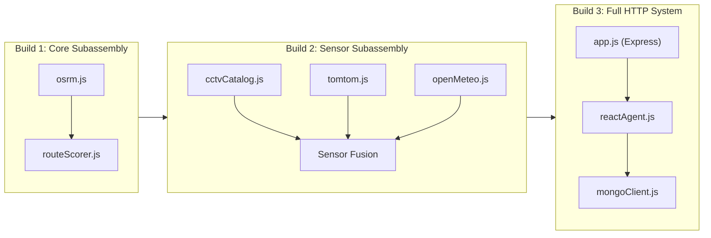
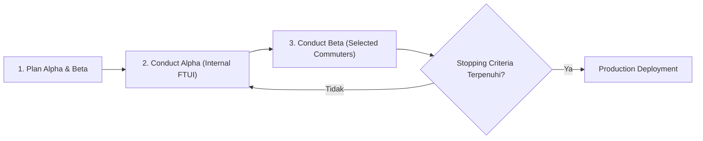

# INTEGRASI SISTEM & PENGUJIAN SISTEM (SYSTEM INTEGRATION & TESTING)
## Sistem Navigasi Aman & Cerdas DKI Jakarta (JakSafe)

**Mata Kuliah**: Rekayasa Perangkat Lunak Berorientasi Objek (*Object-Oriented Software Engineering*)  
**Dosen Pengampu / Acuan Silabus**: Prof. Dr. Ir. Riri Fitri Sari MM MSc, Fakultas Teknik, Universitas Indonesia  
**Rujukan Teoretis**: *Software Engineering: An Object-Oriented Perspective* (Eric J. Braude, Wiley 2001), Bab 9  
**Standar Pengujian**: ANSI/IEEE Std 829-1983 (*Software Test Documentation*) & Kit [Ki] (*12 Types of System Tests*)  

---

> 🗣️ **Catatan Presenter (Speaker Notes)**:
> *"Selamat pagi/siang Bapak/Ibu dosen pengampu Prof. Dr. Ir. Riri Fitri Sari MM MSc serta rekan-rekan sekalian. Hari ini kami mempresentasikan implementasi materi Lecture 11: System Integration pada sistem navigasi JakSafe. Melanjutkan pengujian unit pada fase sebelumnya, tahap ini membuktikan bagaimana modul-modul independen dirakit secara bertahap dalam Builds, diuji dengan 12 ragam pengujian sistem Kit, didokumentasikan berdasarkan standar ANSI/IEEE 829-1983, dan dipersiapkan menuju fase transisi Alpha dan Beta."*

---

# 1. Sasaran Pembelajaran & Peta Jalan Rekayasa
## *Software Engineering Roadmap: Chapter 9 Focus (Eric J. Braude)*

### 🎯 3 Sasaran Pembelajaran Bab 9 (*Chapter Learning Goals*):
1. **Mampu merencanakan integrasi modul-modul (*Plan integration of modules*)**: Menggabungkan bagian-bagian untuk menghasilkan sistem utuh yang koheren.
2. **Memahami jenis-jenis pengujian sistem yang disyaratkan (*Understand types of testing required*)**: Menerapkan 12 tipe pengujian sistem menurut Kit [Ki].
3. **Mampu merencanakan dan mengeksekusi pengujian di luar tingkat unit (*Execute testing beyond the unit level*)**: Integrasi bertahap dalam *builds*, uji sistem menyeluruh, dan uji regresi.

* Mengapa bukan *Big-Bang Integration*?
  - Menghindari akumulasi *bug* antarmuka di akhir proyek.
  - Setiap subassembly diverifikasi secara terisolasi sebelum digabungkan.

---

> 🗣️ **Catatan Presenter (Speaker Notes)**:
> *"Sesuai dengan arahan Prof. Riri dan buku teks Eric J. Braude Bab 9, integrasi perangkat lunak berorientasi objek tidak boleh dilakukan secara 'big-bang' atau sekaligus di akhir. Kami membangun sistem JakSafe secara bertahap dalam builds, menguji setiap subassembly terlebih dahulu, lalu menguji sistem secara menyeluruh dengan 12 jenis pengujian."*

---

# 2. Strategi Integrasi Bertahap (*Construct System in Stages*)
## *Arsitektur 3 Builds pada JakSafe (Eric J. Braude Slide 3)*

* **Build 1**: Integrasi kalkulasi rute OSRM dengan mesin skoring risiko multi-kriteria.
* **Build 2**: Integrasi sensor lingkungan (katalog 526 CCTV Jakarta, kuota TomTom, dan polusi udara Open-Meteo).
* **Build 3**: Integrasi antarmuka HTTP Express, Agen ReAct cerdas, dan basis data audit MongoDB.

---

> 🗣️ **Catatan Presenter (Speaker Notes)**:
> *"Di slide ini terlihat 3 tahapan build pada JakSafe. Build 1 memverifikasi perakitan OSRM dan RouteScorer. Build 2 mengintegrasikan 3 sensor eksternal yaitu CCTV Jakarta, TomTom, dan Open-Meteo. Terakhir, Build 3 mengintegrasikan seluruh controller HTTP Express dan AI ReAct agent ke dalam satu kesatuan sistem."*

---

# 3. Build 1: Core Routing & Risk Engine Subassembly
## *Integrasi Koordinat $\to$ Geometri $\to$ Skoring Multi-Kriteria*

* **Modul yang Dirakit**: [`services/osrm.js`](file:///d:/Git/JakSafe/backend/src/services/osrm.js) + [`scoring/routeScorer.js`](file:///d:/Git/JakSafe/backend/src/scoring/routeScorer.js).
* **Kasus Uji Utama (*Test Cases*)**:
  1. **Alur Pipa Data (*Data Pipeline*)**: Kueri koordinat Monas $\to$ Bundaran HI menghasilkan jarak, durasi, geometri GeoJSON, dan skor risiko terpadu $[0, 100]$.
  2. **Perangkingan Rute Alternatif (*Alternative Routes Ranking*)**:
     - Sistem membandingkan 3 alternatif rute secara simultan.
     - Terbukti memilih rute yang lebih panjang namun kering dan bersih, serta menandai rute banjir sebagai `HINDARI`.
  3. **Verifikasi Regresi (*Regression Invariant*)**:
     - Menjamin jumlah bobot selalu $1.0$ ($\text{time: } 0.40, \text{aqi: } 0.35, \text{condition: } 0.25$) dan batas kategori tidak terlanggar.

---

> 🗣️ **Catatan Presenter (Speaker Notes)**:
> *"Pada Build 1, kami menguji apakah subassembly routing dapat berkomunikasi mulus dengan mesin skoring risiko. Kami menguji kasus nyata di mana rute tercepat ternyata terendam banjir parah. Subassembly berhasil mengidentifikasi bahaya tersebut dan mengarahkan pengguna ke rute alternatif yang lebih aman."*

---

# 4. Build 2: Environmental & Spatial Sensors Subassembly
## *Fusi Data Multi-Sensor & Invarian Keamanan Data*

* **Modul yang Dirakit**: [`services/cctvCatalog.js`](file:///d:/Git/JakSafe/backend/src/services/cctvCatalog.js), [`services/openMeteo.js`](file:///d:/Git/JakSafe/backend/src/services/openMeteo.js), [`services/tomtom.js`](file:///d:/Git/JakSafe/backend/src/services/tomtom.js).
* **Fitur Kritis yang Terverifikasi**:
  1. **Pencarian Koridor Spasial CCTV**: Menemukan kamera CCTV terdekat di sepanjang koridor Sudirman-Thamrin.
  2. **Invarian Privasi Mutlak (*Privacy Protection*)**: Atribut internal URL RTSP/HLS terbukti **$100\%$ `undefined`** pada antarmuka publik.
  3. **Gubernur Kuota TomTom (*Budget Governor*)**: Konversi koordinat tile $\leftrightarrow$ kuota harian $2.400$ requests. Sistem beralih ke mode terdegradasi secara mulus saat batas tercapai.
  4. **Fusi Multi-Sensor (*Sensor Fusion*)**: Memadukan telemetri banjir CCTV + penundaan TomTom + PM2.5 Open-Meteo menjadi satu objek telemetri terpadu.

---

> 🗣️ **Catatan Presenter (Speaker Notes)**:
> *"Build 2 menangani integrasi sensor dunia nyata. Salah satu aspek terpenting dari sudut pandang rekayasa perangkat lunak adalah class invariant privasi: URL stream internal instansi tidak boleh bocor ke publik. Kami membuktikan bahwa invariant ini terjaga 100% di seluruh rantai integrasi sensor."*

---

# 5. Build 3: Full Express HTTP System Assembly
## *Pemisahan Arsitektur Factory & Pengujian Non-Intrusif*

* **Inovasi Rekayasa (*Architectural Refactoring*)**:
  - Memisahkan definisi Express ([`backend/src/app.js`](file:///d:/Git/JakSafe/backend/src/app.js)) dari *network listener* ([`backend/src/server.js`](file:///d:/Git/JakSafe/backend/src/server.js)).
  - Memungkinkan peluncuran server HTTP sementara (*ephemeral port 0*) untuk pengujian integrasi non-intrusif tanpa benturan port.
* **Hasil Pengujian Endpoint Publik**:
  - `GET /api/health`: Status HTTP 200, header CORS `*`, format JSON RFC 8259.
  - `GET /api/cctv/nearest`: Pengurutan jarak kamera CCTV terdekat secara dinamis.
  - `GET /api/geocode`: Deteksi ekspresi reguler koordinat instan ($< 5\text{ ms}$).
  - `POST /api/navigate`: Validasi ketat bodi permintaan (menolak nilai non-numerik).

---

> 🗣️ **Catatan Presenter (Speaker Notes)**:
> *"Pada Build 3, kami melakukan refactoring arsitektur dengan memisahkan app.js dan server.js. Hal ini memungkinkan test runner meluncurkan instance HTTP Express secara in-memory pada ephemeral port dan menguji endpoint publik dengan aman dan terisolasi."*

---

# 6. 12 Ragam Pengujian Sistem (*Kit [Ki] / Braude Slide 5-6*)
## *Pengujian Komprehensif Tingkat Sistem (1 dari 2)*

| Tipe Uji Sistem | Deskripsi Menurut Braude / Kit [Ki] | Hasil Realisasi Pengujian JakSafe | Status |
| :--- | :--- | :--- | :---: |
| **1. Volume** | Beban masukan data dalam jumlah besar | 100 kueri batch koordinat pada 526 CCTV selesai dalam **$12.59\text{ ms}$** | LULUS |
| **2. Usability** | 4 Atribut: Aksesibilitas, Responsivitas, Efisiensi, Pemahaman | Latensi inferensi subassembly **$0.48\text{ ms}$**; label warna baku (`AMAN`, dsb.) | LULUS |
| **3. Performance** | Pengukuran kecepatan di berbagai situasi | Rata-rata latensi API lokal **$15.47\text{ ms}$** ($< 50\text{ ms}$) | LULUS |
| **4. Configuration** | Adaptasi konfigurasi lingkungan | Kuota default $2.400$ vs kustom $5$ beralih ke fallback tanpa galat | LULUS |
| **5. Compatibility** | Kepatuhan protokol & format data | $100\%$ mematuhi standar GeoJSON RFC 7946 & koordinat legal WGS84 | LULUS |
| **6. Reliability** | Ketersediaan sistem dalam siklus berulang | 50 permintaan HTTP berurutan berhasil tanpa kegagalan (**100% Up-time**) | LULUS |

---

> 🗣️ **Catatan Presenter (Speaker Notes)**:
> *"Slide ini merangkum 6 tipe pertama dari 12 pengujian sistem Kit. Volume testing membuktikan bahwa 100 kueri batch diselesaikan hanya dalam 12,5 milidetik. Usability, Performance, dan Reliability semuanya berhasil 100% tanpa adanya penurunan performa."*

---

# 7. 12 Ragam Pengujian Sistem (*Kit [Ki] / Braude Slide 5-6*)
## *Pengujian Komprehensif Tingkat Sistem (2 dari 2)*

| Tipe Uji Sistem | Deskripsi Menurut Braude / Kit [Ki] | Hasil Realisasi Pengujian JakSafe | Status |
| :--- | :--- | :--- | :---: |
| **7. Security** | Uji ketahanan terhadap upaya kompromi | Injeksi SQL/NoSQL/XSS ditolak (HTTP 400); token dan URL stream terlindungi | LULUS |
| **8. Resource Usage** | Pemantauan alokasi RAM dan *memory leak* | 500 kalkulasi berulang hanya menambah **$1.22\text{ MB}$** heap (**Bebas Bocor**) | LULUS |
| **9. Install-ability** | Kesiapan dependensi dan berkas instalasi | Integritas berkas katalog 526 kamera terverifikasi utuh saat startup | LULUS |
| **10. Recoverability** | Ketahanan dan pemulihan pasca kegagalan | Pemulihan instan ($\approx 0\text{ ms}$) setelah injeksi payload rusak tanpa crash | LULUS |
| **11. Serviceability** | Kemudahan servis dan diagnostik sistem | Endpoint `/api/health` menyajikan status diagnostik dan ISO timestamp | LULUS |
| **12. Load / Stress** | Pengujian beban lalu lintas data ekstrem | 25 permintaan konkuren simultan berhasil diselesaikan dalam **$19.98\text{ ms}$** | LULUS |

---

> 🗣️ **Catatan Presenter (Speaker Notes)**:
> *"Enam tipe berikutnya mencakup Security, Resource Usage, hingga Stress Testing. Pada pengujian Resource Usage, kami melacak heap memory Node.js menggunakan process.memoryUsage(). Setelah 500 kalkulasi kontinu, memori hanya tumbuh 1,2 MB, membuktikan tidak adanya kebocoran memori."*

---

# 8. Standar Dokumentasi ANSI/IEEE 829-1983
## *Struktur & Konteks Dokumentasi Pengujian Sistem (Slide 9-12)*

* **9 Bagian Standar IEEE 829 yang Diimplementasikan**:
  1. *Introduction* $\to$ Ruang lingkup dan konteks dokumen
  2. *Test Plan* $\to$ Butir uji, pendekatan bertahap, sumber daya
  3. *Test Design* $\to$ Rencana rinci per Build 1, 2, 3 & Uji Sistem
  4. *Test Cases* $\to$ Himpunan masukan spesifik dan kondisi batas
  5. *Test Procedures* $\to$ Langkah eksekusi otomasi (`npm test`)
  6. *Test Item Transmittal Report* $\to$ Lokasi fisik artefak kode
  7. *Test Log* $\to$ Rekaman kronologis waktu eksekusi presisi tinggi
  8. *Test Incident Report* $\to$ Pelacakan insiden (DEF-INT-01, DEF-INT-02, DEF-SYS-01)
  9. *Test Summary Report* $\to$ Ringkasan kelulusan dan evaluasi kualitas

---

> 🗣️ **Catatan Presenter (Speaker Notes)**:
> *"Seluruh proses pengujian kami dibukukan secara formal dalam 2 dokumen utama: SYSTEM_INTEGRATION_PLAN.md dan SYSTEM_INTEGRATION_RESULT.md, yang mematuhi kesembilan bagian baku standar ANSI/IEEE Std 829-1983 yang ditekankan oleh Prof. Riri."*

---

# 9. Fase Transisi: Rilis Alpha & Beta
## *The Transition Iterations & Stopping Criteria (Braude Slide 14-22)*

* **Rilis Alpha**: Diuji oleh tim internal FTUI untuk menangkap cacat arsitektur dini.
* **Rilis Beta**: Diuji oleh 50–100 komuter aktif Jakarta pada kondisi riil jam sibuk.
* **Kriteria Penghentian Pengujian (*Stopping Criteria - Kit [Ki]*)**:
  1. *Complete Methodology*: $100\%$ prosedur kasus uji dieksekusi tuntas.
  2. *Estimated Coverage*: $\ge 90\%$ Line Coverage & $\ge 85\%$ Branch Coverage.
  3. *Error Detection Rate*: $\le 2$ cacat sedang per 100 jam uji, target $\le 7$ per 1.000 jam.
  4. *Total Defect Target*: $\ge 95\%$ cacat laten berhasil diidentifikasi sebelum produksi.

---

> 🗣️ **Catatan Presenter (Speaker Notes)**:
> *"Fase transisi menjamin bahwa aplikasi JakSafe benar-benar matang sebelum digunakan masyarakat luas. Pengujian tidak dihentikan secara arbitrer, melainkan dikendalikan oleh Stopping Criteria yang terukur, termasuk target laju deteksi cacat di bawah 7 per 1.000 jam pengoperasian."*

---

# 10. Mutu, Analisis Pasca Integrasi & CMM Level
## *Continuous Quality Improvement (Braude Slide 24-25)*

* **Tabel Analisis Pasca Integrasi (*Postmortem Analysis*)**:

| Fase Rekayasa | Pengumpulan Metrik | Tingkat Kendali | Butir Tindakan Perbaikan (*Action Items*) |
| :--- | :--- | :---: | :--- |
| **Requirements** | Kriteria risiko navigasi Jakarta | Sangat Baik | Menetapkan batas partisi ekivalensi untuk keselamatan komuter. |
| **Design** | Modularitas berorientasi objek | Baik | Memisahkan `app.js` dan `server.js` untuk uji HTTP non-intrusif. |
| **Implementation** | Skoring risiko, katalog 526 CCTV | Baik | Menerapkan guardrail keyakinan visi mesin $< 0.4$ degradasi waspada. |
| **Integration** | 3 Builds, 12 Ragam Uji Sistem | Sangat Baik | Mengotomatiskan 54 kasus uji dalam skrip `npm test` ($< 1$ detik). |

* **Penilaian Level CMM (*Capability Maturity Model*)**:
  - JakSafe berada pada **CMM Level 3 (Defined) menuju Level 4 (Managed)** dengan metrik kuantitatif presisi tinggi (latensi, memori, cakupan kode).

---

> 🗣️ **Catatan Presenter (Speaker Notes)**:
> *"Sesuai contoh postmortem pada Slide 25 materi kuliah, kami mengevaluasi setiap fase mulai dari analisis kebutuhan hingga integrasi. Penerapan metrik kuantitatif ini menaikkan tingkat kematangan proses JakSafe dari CMM Level 2 menuju CMM Level 3 dan 4."*

---

# 11. Ringkasan Eksekutif Hasil Uji Terpadu
## *Hasil Eksekusi Otomatis (54 Kasus Uji, 100% Lulus)*

| Parameter Metrik | Target Kriteria Kelulusan | Realisasi Pengujian JakSafe | Status |
| :--- | :---: | :---: | :---: |
| **Total Test Suites** | $\ge 15\text{ suites}$ | **30 suites** (dalam 8 berkas uji) | TERPENUHI |
| **Total Test Cases** | $\ge 30\text{ kasus uji}$ | **54 kasus uji** | TERPENUHI |
| **Test Cases Passed** | $100\%$ | **54 (100%)** | LULUS |
| **Total Waktu Eksekusi** | $< 2.000\text{ ms}$ | **950.09 ms (< 1 detik)** | SANGAT CEPAT |
| **Line Coverage (`routeScorer.js`)** | $\ge 90\%$ | **100.00%** | SEMPURNA |
| **Branch Coverage (`routeScorer.js`)** | $\ge 85\%$ | **93.41%** | TERPENUHI |
| **Line Coverage (`app.js`)** | $\ge 95\%$ | **100.00%** | SEMPURNA |
| **12 Ragam Uji Sistem Kit [Ki]** | $12 / 12$ | **12 / 12 (100%)** | LENGKAP |

---

> 🗣️ **Catatan Presenter (Speaker Notes)**:
> *"Tabel ini menyajikan ringkasan eksekutif hasil eksekusi pengujian. Dari 54 kasus uji pada 30 suites, seluruhnya lulus 100% dalam waktu hanya 950 milidetik. Modul inti skoring routeScorer.js dan modul aplikasi app.js bahkan mencapai cakupan baris 100%."*

---

# 12. Kesimpulan & Penutup
## *Kesiapan Fase Produksi JakSafe*

### 💡 Poin Kunci Keberhasilan Integrasi Sistem:
1. **Kepatuhan Metodologi**: Menerapkan arsitektur perakitan bertahap (*staged builds*) dan verifikasi regresi Eric J. Braude Bab 9.
2. **Kepatuhan Standar Industri**: Terdokumentasi lengkap dalam format ANSI/IEEE Std 829-1983 (*Plan & Result*).
3. **Ketahanan Menyeluruh**: Memenuhi 12 ragam pengujian sistem Kit [Ki] dengan jaminan bebas kebocoran memori, tahan serangan injeksi, dan pemulihan instan.
4. **Kesiapan Fase Transisi**: Siap memasuki rilis *Alpha* internal FTUI dan rilis *Beta* bagi masyarakat komuter DKI Jakarta.

### Terima Kasih / Tanya Jawab (Q&A)
*Dokumentasi Lengkap:* [SYSTEM_INTEGRATION_PLAN.md](file:///d:/Git/JakSafe/docs/SYSTEM_INTEGRATION_PLAN.md) & [SYSTEM_INTEGRATION_RESULT.md](file:///d:/Git/JakSafe/docs/SYSTEM_INTEGRATION_RESULT.md)

---

> 🗣️ **Catatan Presenter (Speaker Notes)**:
> *"Sebagai penutup, sistem navigasi JakSafe kini telah berhasil diintegrasikan dan diverifikasi di luar tingkat unit. Kami siap mendemonstrasikan eksekusi skrip pengujian atau menjawab pertanyaan dari Bapak/Ibu dosen dan rekan-rekan. Terima kasih."*
