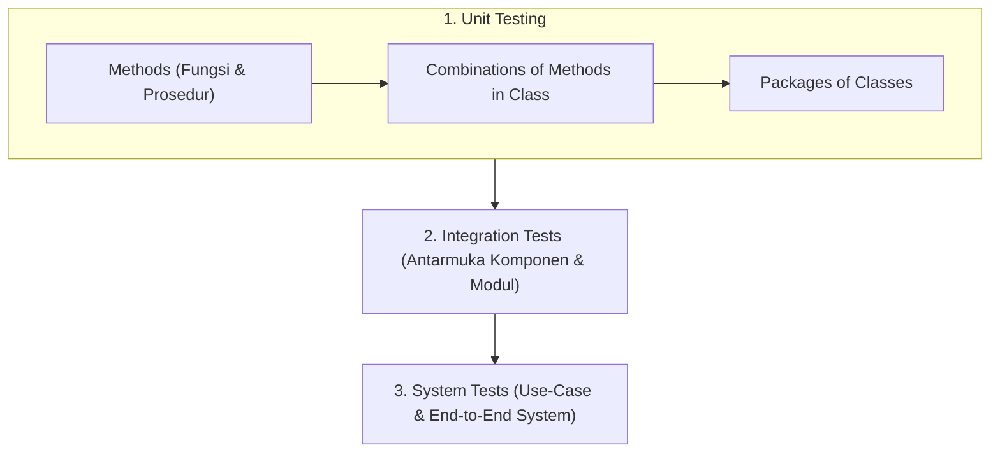
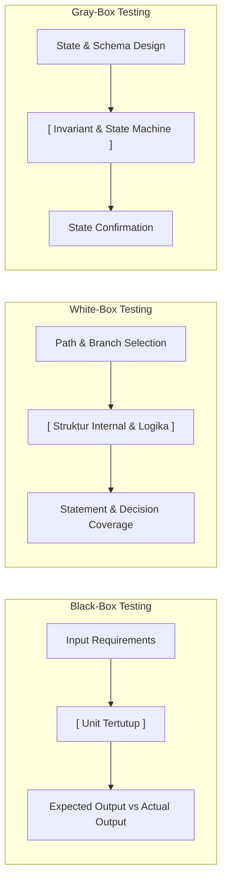
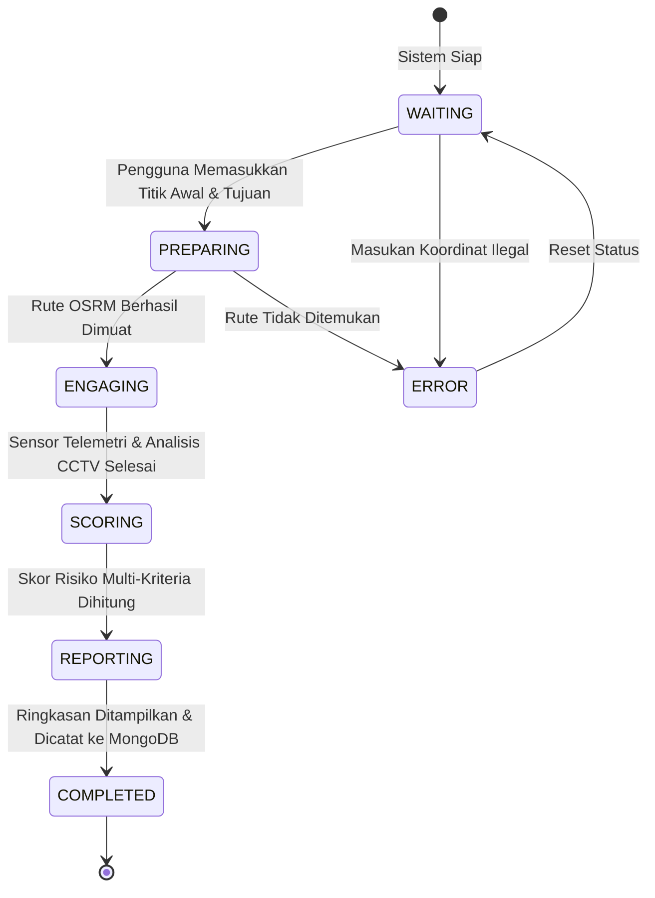

# DOKUMEN RENCANA PENGUJIAN UNIT (UNIT TESTING PLAN)
## Sistem Navigasi Aman & Cerdas DKI Jakarta (JakSafe)

> **Mata Kuliah**: Rekayasa Perangkat Lunak Berorientasi Objek (*Object-Oriented Software Engineering*)  
> **Dosen Pengampu / Acuan Materi**: Prof. Dr. Ir. Riri Fitri Sari MM MSc, Fakultas Teknik, Universitas Indonesia  
> **Rujukan Teori**: *Software Engineering: An Object-Oriented Perspective* oleh Eric J. Braude (John Wiley & Sons, 2001) & Standar IEEE 1008-1987 (*IEEE Standard for Software Unit Testing*)

---

## 1. Pendahuluan & Landasan Teoretis (*Introduction to Unit Testing*)

### 1.1 Kaidah Emas Pengujian (*Golden Rules of Testing*)
1. **Tujuan Utama Pengujian**: Memaksimalkan jumlah dan tingkat keparahan cacat (*defects*) yang ditemukan per rupiah/biaya yang dikeluarkan (*maximize the number and severity of defects found per dollar spent*). Oleh karena itu, pengujian harus dilakukan **sedini mungkin (*test early*)** pada tahap unit terkecil sebelum terintegrasi.
2. **Batasan Pengujian (*Limits of Testing*)**: Pengujian hanya dapat membuktikan keberadaan cacat (*presence of defects*), tetapi **tidak pernah dapat membuktikan ketiadaan cacat (*never their absence*)**. Ketiadaan cacat mutlak hanya dapat dibuktikan melalui pembuktian kebenaran formal (*proofs of correctness*).

### 1.2 Gambaran Besar Pengujian (*Testing: The Big Picture*)
Dalam arsitektur Berorientasi Objek (*Object-Oriented*), hirarki pengujian tersusun sebagai berikut:

Pada siklus *Unified Process*, Unit Testing dilaksanakan secara berulang (*iterative*) mulai dari fase *Inception*, *Elaboration*, hingga *Construction*.

### 1.3 Alur Pengujian Unit (*Roadmap for Unit Testing - IEEE 1986 / Braude*)
1. **Rencana Pengujian (*Plan for Unit Testing*)**: Mengonversi Kebutuhan (*Requirements*) dan Desain Rinci (*Detailed Design*) menjadi Dokumen Rencana Pengujian (*Unit Test Plan*).
2. **Pengadaan Perangkat Uji (*Acquire Test Set*)**: Menyiapkan himpunan kasus uji (*test cases*), data input batas, serta *mock dependencies*.
3. **Pelaksanaan Uji Unit (*Execute Unit Test*)**: Menjalankan kode yang diuji terhadap perangkat uji, mendokumentasikan hasil, dan mengidentifikasi titik rawan utama (*largest trouble spots*).

---

## 2. Rencana Strategis Pengujian Unit (*Plan for Unit Testing - Braude Section 3*)

Mengacu pada 6 pilar perencanaan menurut Eric J. Braude:

1. **Filosofi Pengujian (*Philosophy for Unit Testing*)**:
   - Pengembang modul bertanggung jawab langsung menyusun dan menjalankan pengujian unit (*developer-driven unit testing*).
   - Pengujian diverifikasi silang (*peer review*) sebelum dilakukan penggabungan kode (*merge*) ke cabang utama `main`.
2. **Dokumentasi & Alat Uji (*Documentation & Utilities*)**:
   - Dokumentasi formal diwujudkan dalam dua dokumen: `TESTING_PLAN.md` dan `TESTING_RESULT.md`.
   - Alat uji menggunakan pustaka bawaan Node.js `node:test` dan `node:assert/strict` (bebas dependensi eksternal, deterministik, dan berkecepatan tinggi) dilengkapi dengan kalkulasi cakupan kode (*code coverage*).
3. **Cakupan Pengujian Ditentukan di Awal (*Determine Extent in Advance*)**:
   - Pengujian tidak dilakukan sekadar "sampai waktu habis" (*do not just test until time expires*).
   - Pengujian diprioritaskan pada modul-modul kritis yang menangani keselamatan pengguna (*risk-driven priority*):
     - **Prioritas 1 (Kritis)**: Mesin Skoring Multi-Kriteria Rute (`routeScorer.js`).
     - **Prioritas 2 (Tinggi)**: Katalog Spasial CCTV & Privasi Data (`cctvCatalog.js`).
     - **Prioritas 3 (Tinggi)**: Manajemen Akuntansi Anggaran Kuota API (`tomtom.js`).
     - **Prioritas 4 (Sedang)**: Alur Transisi State Agen ReAct (`reactAgent.js` / State Machine).
4. **Sumber Masukan Uji (*Decide How and Where to Get Test Input*)**:
   - Koordinat riil jalan arteri DKI Jakarta (Monas, Sudirman, Thamrin, Kuningan).
   - Data katalog riil dari 526 kamera CCTV terverifikasi Jakarta.
   - Kasus sintetis nilai batas (*edge cases*): waktu 0 detik, nilai tak hingga (*Infinity*), nilai bukan angka (*NaN*), koordinat kutub/antipodal, dan batas kuota harian.
5. **Estimasi Sumber Daya (*Estimate Resources Required*)**:
   - Lingkungan eksekusi: Node.js runtime (v24.14.0).
   - Waktu eksekusi pengujian: < 500 ms untuk seluruh rangkaian uji unit.
6. **Pelacakan Cacat (*Track Time, Defect Count, Type & Source*)**:
   - Setiap cacat yang ditemukan diklasifikasikan berdasarkan: Sumber (*Source*), Tipe (*Syntax / Boundary / Logic / Interface*), dan Tingkat Keparahan (*Critical / Major / Minor*).

---

## 3. Jenis & Strategi Pengujian (*Black-, Gray-, & White-box Testing*)

### 3.1 Pengujian Kotak Hitam (*Black-Box Testing*)
Menilai kesesuaian modul terhadap spesifikasi kebutuhan tanpa melihat kode internal.

#### A. Pembagian Partisi Ekivalensi (*Equivalence Partitioning*)
Masukan dibagi menjadi domain legal (valid) dan domain ilegal (tidak valid):

1. **Durasi Waktu Tempuh (*Travel Duration*)**:
   - Partisi Legal Rendah: $0 < t \le 300\text{ s}$ ($\le 5$ menit) &rarr; Skor = 0 (Terbaik).
   - Partisi Legal Normal: $300\text{ s} < t < 3600\text{ s}$ &rarr; Skor linear $[0, 100]$.
   - Partisi Legal Tinggi: $t \ge 3600\text{ s}$ ($\ge 60$ menit) &rarr; Skor = 100 (Terburuk).
   - Partisi Ilegal: $t \le 0$, $t = \text{NaN}$, $t = \infty$ &rarr; Nilai aman bawaan (*neutral fallback* = 50).
2. **Kualitas Udara Partikulat PM2.5**:
   - Partisi Bersih: $\le 12\ \mu\text{g/m}^3$ &rarr; Skor = 0.
   - Partisi Sedang/Tinggi: $12\ \mu\text{g/m}^3 < \text{PM2.5} < 150\ \mu\text{g/m}^3$ &rarr; Skor linear.
   - Partisi Sangat Berbahaya: $\ge 150\ \mu\text{g/m}^3$ &rarr; Skor = 100.
   - Partisi Ilegal: Nilai non-numerik / data kosong &rarr; Skor netral 50.

#### B. Analisis Nilai Batas (*Boundary Value Analysis*)
Pengujian wajib mengevaluasi 3 titik dasar pada rentang:
1. **Di dalam rentang (*within range*)**: Titik tengah nominal.
2. **Tepat di batas rentang (*at the boundaries*)**: Nilai minimum dan maksimum batas.
3. **Di luar batas rentang (*outside range / illegal*)**: Tepat di bawah batas minimum dan di atas batas maksimum.

| Parameter | Batas Bawah Ilegal | Batas Bawah Legal | Titik Tengah | Batas Atas Legal | Batas Atas Ilegal |
| :--- | :---: | :---: | :---: | :---: | :---: |
| Durasi ($t$) | $0\text{ s}, -10\text{ s}$ | $300\text{ s}$ ($5\text{ m}$) | $1950\text{ s}$ ($32.5\text{ m}$) | $3600\text{ s}$ ($60\text{ m}$) | $3601\text{ s}, 7200\text{ s}$ |
| PM2.5 | $-1.0$ | $12.0\ \mu\text{g/m}^3$ | $81.0\ \mu\text{g/m}^3$ | $150.0\ \mu\text{g/m}^3$ | $250.0\ \mu\text{g/m}^3$ |
| Kuota TomTom | $-1$ | $0$ | $1200$ | $2400$ | $2401$ |
| Sudut Lintang | $-90.1^\circ$ | $-90.0^\circ$ | $-6.2^\circ$ (Jakarta) | $+90.0^\circ$ | $+90.1^\circ$ |

---

### 3.2 Pengujian Kotak Putih (*White-Box Testing*)
Memverifikasi struktur internal, alur kendali, dan logika percabangan.

#### A. Peringatan Myers: Cakupan Pernyataan Saja Tidak Cukup!
Mengutip materi kuliah Eric J. Braude / Glenford Myers:
> *"Covering every statement is not sufficient."*

Suatu himpunan uji yang mengeksekusi 100% baris kode dapat melewatkan cacat logika fatal jika percabangan (*decision paths*) tidak diuji pada kedua sisinya (*True* dan *False*).

#### B. Analisis Percabangan Logika (*Decision Coverage / Branch Coverage*)
Pada fungsi penentuan kondisi jalan [`normalizeConditionScore`](file:///d:/Git/JakSafe/backend/src/scoring/routeScorer.js#L71-L112), seluruh cabang berikut harus dieksekusi:
- **Cabang 1 (Penutupan Jalan)**: `trafficData.roadClosure === true` &rarr; Langsung mengembalikan 100 (*short-circuit*).
- **Cabang 2 (Tingkat Banjir Gemini Vision)**:
  - `tingkat_genangan === 'rendah' || 'ringan'` &rarr; 35
  - `tingkat_genangan === 'sedang'` &rarr; 65
  - `tingkat_genangan === 'tinggi' || 'berat'` &rarr; 95
  - Nilai tingkat genangan tidak dikenal &rarr; 50
- **Cabang 3 (Persentase Keterlambatan TomTom)**:
  - `delayPercent >= 80` &rarr; 30 (Macet parah)
  - `delayPercent >= 30` &rarr; 15 (Macet sedang)
  - `delayPercent < 30` &rarr; 0 (Lancar)
- **Cabang 4 (Guardrail Etika Keyakinan Rendah)**:
  - `confidence < 0.4` &rarr; Memaksa skor kondisi minimal 45 (*Hati-hati*) untuk mencegah rasa aman palsu akibat kesalahan penglihatan komputer.

---

## 4. Daftar Periksa Pengujian Metode (*Humphrey Checklist - Braude Section 4*)

Berdasarkan metodologi Watts Humphrey (1995) yang disajikan dalam materi kuliah:

- [x] **1. Verifikasi operasi pada nilai parameter normal (*Normal parameter values*)**: Uji rute nominal Jakarta.
- [x] **2. Verifikasi operasi pada nilai parameter batas (*Limit parameter values*)**: Uji batas radius pencarian kamera = 0, limit = 1.
- [x] **3. Verifikasi operasi di luar rentang parameter (*Outside / Illegal parameter values*)**: Uji radius negatif, durasi negatif, koordinat NaN.
- [x] **4. Pastikan semua instruksi dieksekusi (*Statement coverage*)**: Target $\ge 85\%$ pada modul skoring dan katalog.
- [x] **5. Periksa semua jalur dan kedua sisi cabang (*Decision coverage*)**: Memastikan jalur *True* dan *False* teruji.
- [x] **6. Periksa penggunaan objek yang dipanggil (*Use of all called objects*)**: Verifikasi interaksi fungsi Haversine, normalizer, dan logger.
- [x] **7. Verifikasi penanganan seluruh struktur data (*Handling of all data structures*)**: Set deduplikasi kamera CCTV, Array pemetaan rute.
- [x] **8. Verifikasi penanganan berkas (*Handling of all files*)**: Validasi pemuatan berkas `cctvCatalog.json` dan penanganan jika berkas tidak ditemukan atau rusak.
- [x] **9. Periksa penghentian normal seluruh perulangan (*Normal termination of loops*)**: Loop penelusuran katalog kamera selesai dengan benar.
- [x] **10. Periksa penghentian abnormal perulangan (*Abnormal termination of loops*)**: Penanganan data katalog kosong atau terpotong.
- [x] **13. Verifikasi penanganan kondisi kesalahan (*Handling of error conditions*)**: Menangkap error *JSON parse* dan koordinat tidak valid tanpa mematikan server.
- [x] **14. Periksa sinkronisasi & pewaktuan (*Timing and synchronization*)**: Uji transisi status async pada alur agen ReAct.
- [x] **15. Verifikasi dependensi eksternal (*External dependencies*)**: Mekanisme fallback saat layanan pihak ketiga (Google/TomTom/Gemini) tidak dapat diakses.

---

## 5. Rencana Pengujian Kelas & Status Objek (*Class & State Testing - Braude Section 5*)

### 5.1 Pengujian Kombinasi Metode (*Methods in Combination*)
Menguji urutan metode yang saling mempengaruhi atribut secara berurutan:
$$\text{Hitung Durasi} \longrightarrow \text{Normalisasi AQI} \longrightarrow \text{Evaluasi Kondisi Fisik} \longrightarrow \text{Agregasi Bobot}$$
Membandingkan hasil kalkulasi sistem dengan nilai hitungan manual (*hand-computed values*).

### 5.2 Pengujian Invarian Kelas (*Class Invariants*)
Invarian adalah kondisi yang **wajib selalu bernilai Benar (*True*)** sebelum dan sesudah suatu metode dieksekusi:
1. **Invarian Privasi Kamera CCTV**:
   $$\forall c \in \text{Catalog},\ \text{publicView}(c).\text{url} \equiv \text{undefined}$$
   *URL streaming RTSP/HLS internal pemerintah DKI tidak boleh bocor ke publik.*
2. **Invarian Normalisasi Bobot**:
   $$\sum w_i = w_{\text{time}} + w_{\text{aqi}} + w_{\text{condition}} \equiv 1.0$$
3. **Invarian Batas Skor Akhir**:
   $$\forall \text{input},\ 0 \le \text{totalScore} \le 100$$

### 5.3 Pengujian Transisi Status (*State-Transition Testing*)
Mengadaptasi model *Encounter State-Transition* dari Eric J. Braude ke alur navigasi JakSafe:

Pengujian harus membuktikan:
1. Transisi sekuensial dari status `WAITING` hingga `COMPLETED` berjalan mulus.
2. Lompatan status ilegal (misalnya dari `WAITING` langsung memanggil `ENGAGING` tanpa rute) ditolak dan memunculkan *exception*.
